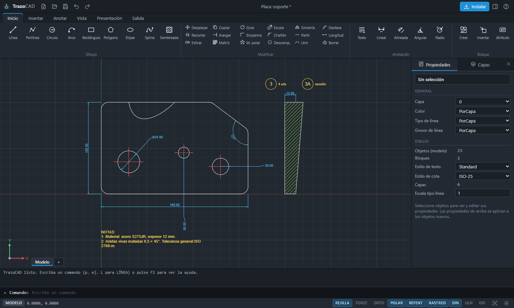
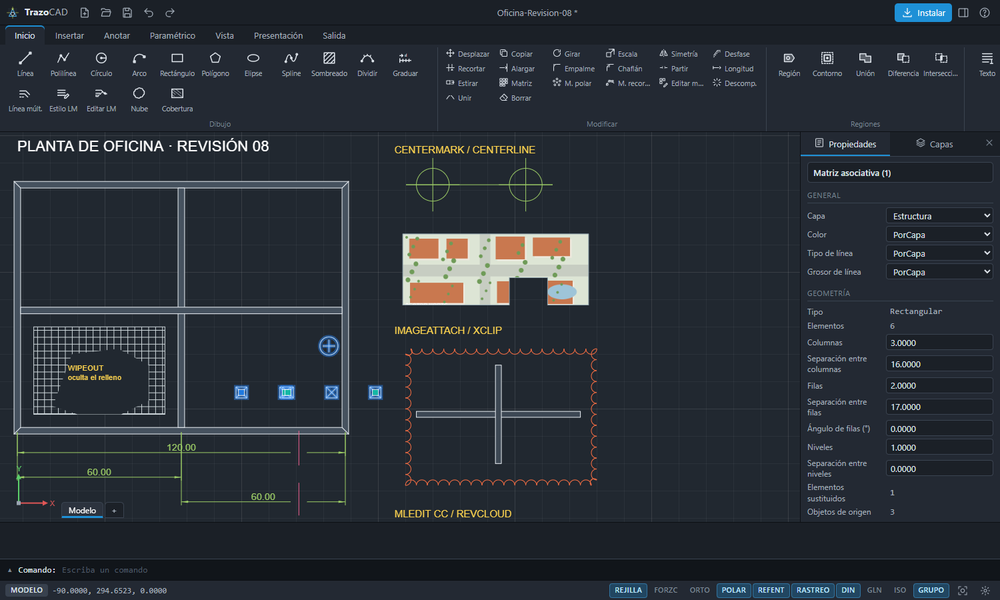

# TrazoCAD — v0.12

Software de dibujo técnico 2D inspirado en AutoCAD, hecho desde cero como **PWA** (aplicación web instalable y sin conexión). JavaScript puro con módulos ES: sin dependencias ni compilación.



## Ejecutar

```bash
node serve.mjs          # http://localhost:8080
```

Una PWA necesita `http://localhost` o HTTPS. Para publicarla, sube la carpeta tal cual a cualquier hosting estático con HTTPS (GitHub Pages, Netlify, Hostinger…). En Chrome/Edge aparece el botón **Instalar**.

## Novedades de la v0.12


| Función | Detalle |
|---|---|
| **Vistas giradas** (`PLAN`, `DVIEW`) | `PLAN` alinea la vista con el SCP actual, con uno con nombre o con el universal, para trabajar con una recta o una curva del eje en horizontal; `DVIEW` (`VIEWTWIST`) gira la vista un ángulo, según **dos puntos** o alineada con un **objeto** (línea, tramo de polilínea, arco, texto), y la restablece. Con `UCSFOLLOW` = 1 la vista sigue al SCP. Zoom, encuadre, **designación por ventana y captura** (un rectángulo de la pantalla), **rejilla**, cursor, icono del SCP, **rastreo** (horizontal y vertical de la pantalla), polar, ZOOM Ventana, `STRETCH` y las **vistas con nombre** (que guardan el giro) funcionan con la vista girada. Las ventanas en mosaico tienen cada una su giro, y la vista girada se guarda con el dibujo y se exporta a PNG, SVG y PDF tal como se ve |
| **Ventanas gráficas giradas** | Propiedad **Giro** de las ventanas gráficas en la paleta Propiedades, como en las láminas de planta de una ruta, donde cada tramo se orienta según su dirección; `PLAN` dentro de una ventana la gira **conservando su escala**. Al girar una ventana con `GIRA` la vista del modelo gira con ella (`VPROTATEASSOC` = 1). Se dibujan giradas en pantalla, en la impresión, en **PDF** y **SVG**, y en **DXF** se escriben y se leen con su VIEWTWIST y el centro en coordenadas de la vista (también la vista `*ACTIVE` del modelo y las vistas con nombre) |
| **SCP por ventana** (`UCSVP`) | Con `UCSVP` = 1 cada ventana en mosaico y cada ventana gráfica conserva su propio SCP: se restituye al activarla y se guarda al salir (las ventanas nuevas heredan el de aquélla desde la que se dividió) |
| **Escalas anotativas** | Lista de escalas del dibujo (`SCALELISTEDIT`: añadir, suprimir, restablecer); **escala de anotación actual** en la barra de estado (`CANNOSCALE`), que en una ventana gráfica es la suya (cambiarla cambia la escala de la ventana). Estilos de **texto, cota y directriz** con la casilla *Anotativo* (sus tamaños son los del papel), propiedad **Anotativo** de textos, textos de líneas múltiples, atributos, cotas, directrices, sombreados y bloques (`ANNOTATIVE`), y **una representación por escala**: cada ventana dibuja el objeto con la suya. `OBJECTSCALE`, `AIOBJECTSCALEADD` y `AIOBJECTSCALEREMOVE` añaden o quitan escalas; los objetos sin la escala actual se ven **atenuados** o se ocultan (`ANNOALLVISIBLE`, botón ANOT), y con `ANNOAUTOSCALE` = 1 la escala nueva se añade sola. `HPANNOTATIVE` hace anotativos los sombreados nuevos |
| **Guiones** (`SCRIPT`, `ACTRECORD`) | Archivos `.scr` con las mismas órdenes y respuestas de la línea de comandos (espacio o fin de línea = Intro; los textos con espacios toman el resto de la línea; `;` comenta). **Un punto escrito designa el objeto que pasa por él**, también al designar objetos. `ACTRECORD` / `ACTSTOP` **graban** lo que se hace (órdenes, lo escrito, los puntos y lo designado con el ratón) como un guion `.scr` que se vuelve a ejecutar; `DELAY` hace pausas. Una orden que abre un diálogo detiene el guion con un aviso, y Esc lo interrumpe |
| **API en JavaScript** (`JSCONSOLE`, `APPLOAD`, `JSEVAL`) | La API `tc` (también `window.tc`) **crea** objetos (`tc.line`, `circle`, `arc`, `pline`, `text`, `mtext`, `insert`…), los **consulta** (`get`, `all({type, layer})`, `selection`, `select`), los **modifica** (`modify`, `erase`, `transaction`, `layer`), **ejecuta órdenes** con sus respuestas (`tc.command('CIRCLE', [0, 0], 5)`) y guiones, y **define órdenes nuevas** con alias (`tc.defineCommand('MARCAPK', {aliases, desc, fn})`), que reciben las mismas peticiones que las de TrazoCAD (`getPoint`, `getSelection`, `getString`…). Cada llamada fuera de una orden es una operación de deshacer. Consola con Ctrl+Intro, `JSEVAL` para una línea (también desde un guion) y `APPLOAD` para archivos `.js` (o `.scr`), que pueden **cargarse al iniciar** |
| **Paleta de herramientas** (`TOOLPALETTES`) | Pestaña *Herramientas* de la paleta lateral con grupos de **Señalización**, **Obras de arte**, **Seguridad vial**, **Drenaje**, **Sombreados** y **Órdenes**. Cada herramienta guarda sus propiedades (capa, color, escala, rotación y estado de visibilidad de un bloque; patrón, escala y ángulo de un sombreado; o una orden o línea de guion) y se usa con un clic o **arrastrándola al dibujo** (el bloque se coloca donde se suelta y el sombreado rellena esa zona). Se crean herramientas **desde la designación**, se editan, reordenan y eliminan, y las paletas se guardan en el navegador |
| **Biblioteca de obras viales** (`LIBINSERT`) | Bloques generados por TrazoCAD: **señales** reglamentarias (velocidad máxima, prohibido adelantar, estacionar, girar, el paso, peso máximo, con estados de visibilidad), Pare, Ceda el paso, **preventivas** en rombo y en triángulo (curvas, cruce, estrechamiento, obras, puente angosto, animales), **informativa** de destinos (ancho ajustable) y mojón kilométrico, todas **anotativas** y con atributos (valor, código, progresiva, lado); **alcantarillas** de caño (Ø 0,60 a 1,50 m) y de **cajón** con luz y altura ajustables y **tabla de medidas**, cabecera de caño, **defensa metálica** (tramo de 4 m para repetir con ARRAYPATH, terminal y sección), **cordón cuneta** de ancho ajustable, cordón barrera y **cunetas** trapezoidal (fondo y profundidad) y triangular. Los planos tipo están en metros y se insertan con el factor de `LIBUNITS` (m, cm o mm) |
| **DesignCenter** (`ADCENTER`) | Explora la biblioteca, el dibujo actual y otros dibujos `.tcad` o `.dxf` abiertos desde él: inserta sus **bloques** (con los bloques anidados, las capas y los estilos de texto que usan) y añade al dibujo sus **capas** y **estilos** de texto, cota, directriz, tabla y línea múltiple |
| **Otros** | Pestaña **Administrar** de la cinta (paletas, biblioteca y automatización), grupo *Vista girada* en Vista y *Escalas de anotación* en Anotar; INSERT admite los nombres de la biblioteca y pregunta una sola vez cada etiqueta de atributo. Archivos `.tcad` versión 12 (los anteriores se siguen abriendo); la ayuda (F1) recoge las novedades |

## Novedades de la v0.11


| Función | Detalle |
|---|---|
| **Sistemas de coordenadas personales** (`UCS`, `SCP`) | Origen y punto del eje X, **3 puntos**, alineado con un **objeto** (línea, arco, círculo, polilínea, texto, bloque…), giro **Z**, **Previo** (hasta 10) y **Universal**; SCP **con nombre** (Guardar, Restituir, Suprimir, ?). Las coordenadas escritas (`x,y`, `@dx,dy`, `d<a`) se miden en el SCP y, con `*` delante (`*x,y`, `@*dx,dy`), en el universal. La barra de estado, ID, la entrada dinámica, ORTO, POLAR, la **rejilla** y FORZC siguen los ejes del SCP, y el cursor gira con él. El SCP se deshace con DESHACER y se guarda en el `.tcad` y en DXF (tabla UCS y `$UCSORG`/`$UCSXDIR`) |
| **Administrador e icono del SCP** (`UCSMAN`, `UCSICON`) | Lista el universal, el previo y los SCP con nombre para establecerlos, guardar el actual, renombrar o suprimir. El icono gira con el SCP, se muestra en su **origen** si cabe en la vista (cruz) o en la esquina, y el cuadrado indica el universal; se puede ocultar |
| **Vistas con nombre** (`VIEW`, `-VIEW`) | Guardan la vista actual o una **ventana** del modelo o de una presentación, con el **SCP** y, si se pide, el estado de las **capas** (activadas y bloqueadas). Restituir cambia al espacio donde se guardó; Actualizar, Renombrar, Suprimir. En DXF se escriben en la tabla VIEW (las de presentación, con su nombre en datos extendidos) y se vuelven a leer |
| **Ventanas en mosaico** (`VPORTS`) | El espacio modelo se divide en **2** (horizontal o vertical), **3** (seis disposiciones) o **4** ventanas, cada una con su vista, zoom y encuadre; la activa tiene el marco azul y se cambia con un clic. La rueda amplía la ventana que está bajo el cursor y la designación se resalta en todas. **Unir** dos ventanas (clic o lado), **Única**, y configuraciones con nombre (Guardar, Restituir, Suprimir). La disposición se guarda con el dibujo. En una presentación, VPORTS crea de una vez 1 a 4 ventanas gráficas en un rectángulo |
| **Selección rápida** (`QSELECT`) | Por **tipo de objeto** y **propiedad** (generales o las de la paleta Propiedades: radio, longitud, área, contenido, altura…) con los operadores =, ≠, >, <, ≥, ≤, **comodín** y *seleccionar todo*; en todo el espacio o dentro de la designación, **incluir o excluir** y **añadir** a la designación actual. Sugiere los valores presentes en el dibujo; los colores se escriben como PorCapa, nombre, número ACI o #rrggbb |
| **Filtros de selección** (`FILTER`, `FI`) | Listas de condiciones (tipo, propiedad, operador, valor y **NO**) combinadas con **Y** u **O**, que se **guardan con nombre** en el dibujo. «Aplicar» pide los objetos (Intro = todo el espacio) y designa los que pasan el filtro |
| **Buscar y reemplazar** (`FIND`, `BUSCAR`) | En **textos**, **textos de líneas múltiples**, **valores y definiciones de atributo**, **textos de cota**, **directrices** y **celdas de tabla**; en el espacio actual, en **todo el dibujo** (modelo y presentaciones) o en la designación; mayúsculas, **palabras completas** y **comodines**. La lista de resultados amplía cada objeto; se reemplazan los marcados o todos (una sola operación de deshacer) y se pueden designar |
| **Objetos duplicados** (`OVERKILL`) | Suprime los objetos iguales dentro de una **tolerancia** (las líneas y polilíneas aunque estén invertidas o empiecen en otro vértice), **ignorando** si se quiere color, capa, tipo y grosor de línea o estilo de trazado; **combina** líneas colineales que se solapan (y, opcionalmente, las que se tocan extremo con extremo) y arcos del mismo círculo (un círculo absorbe los arcos que tiene encima); **optimiza** polilíneas quitando vértices repetidos o alineados |
| **Revisar el dibujo** (`AUDIT`, `REVISAR`) | Comprueba capas, identificadores repetidos, coordenadas no válidas, referencias a bloques, capas y estilos inexistentes, referencias circulares, polilíneas y sombreados vacíos, grupos y restricciones huérfanos y el contador de identificadores; informa y, si se pide, **corrige** |
| **Herramientas de capas** | **LAYISO** aísla las capas de los objetos designados (desactivando o bloqueando las demás) y **LAYUNISO** las deja como estaban; **LAYWALK** recorre las capas mostrando sólo las elegidas (clic, Ctrl+clic o comodines) y las restaura al salir; **LAYMRG** fusiona capas en otra (también dentro de los bloques, ventanas gráficas, estados de capa y filtros). La paleta de capas tiene **filtros por propiedades** (nombre con comodines, color, activada, bloqueada, tipo y grosor de línea, en uso) y **por grupos**, con *Capas en uso* e **Invertir** (`LAYFILTER`) |
| **Otros** | Pestaña Vista con los grupos *Coordenadas* y *Vistas y ventanas*; *Herramientas de capa* y las utilidades nuevas en Inicio. Archivos `.tcad` versión 11 (los anteriores se siguen abriendo); la ayuda (F1) recoge las novedades |

## Novedades de la v0.10


| Función | Detalle |
|---|---|
| **Imágenes a escala real** (`IMAGEATTACH`) | Lee la resolución guardada en el archivo (PNG `pHYs`, JPEG JFIF y EXIF, BMP) y propone el tamaño real; la escala se indica en unidades por píxel, en **píxeles por unidad** o por **resolución** (ppp) con las unidades del dibujo por pulgada (25,4 en milímetros). Propiedades muestra y cambia la **Escala (unidades/píxel)** y la **Resolución** efectiva |
| **Recorte con varios contornos** (`XCLIP` › Añadir contorno) | Una imagen recortada admite contornos adicionales que se combinan par-impar: un contorno dentro de otro abre un hueco y los separados muestran varias zonas. Todos se editan con pinzamientos y se exportan a SVG, PDF y DXF (el primero como contorno de IMAGE; el resto en XDATA propios); «generar Polilínea» crea una por contorno |
| **Tolerancias en cotas** | Estilos de cota con tolerancia **simétrica** (±), **desviación** (+sup/−inf apiladas, con escala de altura), **límites** (máximo sobre mínimo) y **básica** (texto enmarcado), con sus decimales. En DXF se escriben como DIMTOL, DIMLIM, DIMTP, DIMTM, DIMTFAC y DIMTDEC (básica: DIMGAP negativo) y se leen de vuelta |
| **Estilos aplicados por cota** (`DIMOVERRIDE`, `DOV`) | Cambia variables (DIMTXT, DIMASZ, DIMDEC, DIMTOL, DIMTP…) sólo en las cotas designadas, sin tocar su estilo, o **borra** esas modificaciones. Propiedades tiene las secciones *Tolerancias* y *Modificaciones de estilo* y el botón para restablecer. En DXF viajan como XDATA `ACAD`/`DSTYLE`, como en AutoCAD |
| **Islas de sombreado** | Detección de islas **Normal**, **Exterior** o **Ignorar** (HATCH › Detección de islas, también en Propiedades), **Incluir islas** designando objetos y **Quitar islas** con un punto. Los sombreados asociativos recuerdan las islas quitadas al recalcularse; el estilo se guarda en el código 75 del DXF |
| **Degradados de varios colores** | GRADIENT › Colores admite colores intermedios con su posición; Propiedades › **Paradas de color** («0% #2e7d32, 35% #c0ca33, 100% #f5f5f5»). Todos los tipos (lineal, cilíndrico, esférico…) los usan; en pantalla, SVG, PDF y DXF 2007 (código 453 con cada parada) |
| **Referencias externas recordadas** | XATTACH y Recargar guardan en el navegador (IndexedDB) el archivo de cada referencia: al abrir el dibujo otro día se vuelve a leer solo si el navegador mantiene el permiso, y XREF muestra cuáles están «recordadas». En DXF 2000 y 2007 se escriben como **bloques XREF** (indicador 4 y ruta del archivo) con sus capas dependientes `REF\|capa`; TrazoCAD guarda además su contenido en XDATA y lo recupera al importar |
| **Tablas de estilos de trazado** (`STYLESMANAGER`, `CONFIGPAG`) | Tablas **.ctb** (por color ACI) y **.stb** (estilos con nombre por capa u objeto, `ESTILOTRAZADO`) que cambian color, escala de grises, intensidad, grosor y tipo de línea al imprimir y exportar a PDF, SVG y PNG. Predefinidas `monochrome.ctb`, `grayscale.ctb`, `screening 50%.ctb`, `acad.ctb/stb` y `monochrome.stb`; las propias se crean, copian y editan, y se **importan y exportan** como archivos de AutoCAD. CONFIGPAG elige la tabla de cada presentación (o del modelo) y la puede mostrar en pantalla; en DXF va en PLOTSETTINGS |
| **Tipos de línea por ventana** | Cada ventana gráfica tiene su **Escala de tipo de línea** (Propiedades) y `PSLTSCALE` = 1 deja los trazos con el mismo tamaño en el papel en todas las ventanas, sea cual sea su escala |
| **Propiedades de varios objetos** | Con objetos de varios tipos, la cabecera de la paleta elige *Todos* o un tipo (*Círculo (2)*); con un solo tipo se editan sus propiedades geométricas en todos a la vez, con *\*Varios\** donde difieren, en una sola operación de deshacer |
| **Otros** | Archivos `.tcad` versión 10 (los anteriores se siguen abriendo); la ayuda (F1) recoge las novedades. Corregido: SOMBREADO y CONTORNO por punto interior ya no fallan cuando hay una isla a la derecha del punto, a su misma altura |

## Novedades de la v0.9


| Función | Detalle |
|---|---|
| **Imágenes raster completas** (`IMAGEATTACH`, `XCLIP`) | **Transparencia** (0–90, como IMAGEADJUST de AutoCAD) que se respeta en pantalla, SVG y PDF. El recorte es **editable con pinzamientos**: los del contorno mueven cada vértice por separado y los de esquina desplazan la imagen y su recorte juntos. En DXF 2007 y 2000 la imagen se escribe como **IMAGE** con su **IMAGEDEF** (fuente incrustada en datos extendidos troceados) y el recorte y la transparencia en XDATA; en PDF se incrusta el mapa de bits, con su transparencia, escalado a la página |
| **Cortes de cota en DXF** | DIMBREAK escribe sus cortes en la cota (XDATA de DIMENSION) en DXF 2000 y 2007, y al importar se recuperan en su posición y longitud |
| **Matrices reconstruidas** | Al importar un DXF creado con TrazoCAD, las matrices rectangulares, polares y de recorrido vuelven como matrices asociativas con sus parámetros (columnas, filas, separaciones, ángulo de filas, niveles, elementos de origen), no como bloques sueltos |
| **Nubes, coberturas y orden de dibujo** | `REVCLOUDEDIT` añade un arco en el tramo designado, quita el arco designado o convierte la nube en una polilínea normal (con al menos cuatro arcos). `WIPEOUTFRAME` elige el marco de las coberturas (0 oculto, 1 visible e impreso, 2 sólo en pantalla). `DRAWORDER` lleva los objetos designados al frente o detrás del resto. Nuevas herramientas en la cinta |
| **Vértices de líneas múltiples** | Con **Ctrl+clic** en un pinzamiento de vértice se suprime ese vértice; con Ctrl+clic sobre el eje de un tramo se añade uno nuevo, y los cortes de MLEDIT de los tramos afectados se conservan o se ajustan |
| **Otros** | Archivos `.tcad` versión 9 (los anteriores se siguen abriendo). Las nubes de revisión, las coberturas y las imágenes se dibujan también en SVG y PDF; la ayuda (F1) recoge las novedades |

## Novedades de la v0.8



| Función | Detalle |
|---|---|
| **Edición de líneas múltiples** (`MLEDIT`, `-MLEDIT`) | Cuadro de herramientas y opciones por línea de comandos: cruces cerrada, abierta y combinada (CC, OC, MC), uniones en T cerrada, abierta y combinada (CT, OT, MT), unión en esquina (CJ), añadir y suprimir vértices (AV, DV), cortar uno o todo (CS, CA) y soldar (WA). Los cortes se guardan en la línea múltiple, se conservan al mover, girar, copiar y deshacer y se exportan a DXF 2000 y 2007; en R12 la MLINE se descompone con los cortes ya aplicados |
| **Matrices editables** (`ARRAYEDIT`) | **Origen** sustituye los objetos que genera la matriz; **ReemplaZar** sustituye un elemento concreto por otros objetos conservando la asociatividad. La matriz rectangular añade **niveles** con su separación Z y **ángulo de filas** (+ = antihorario, 0 = filas perpendiculares a las columnas). Los pinzamientos y la paleta de Propiedades reflejan los nuevos parámetros |
| **Marcas y líneas de centro** (`CENTERMARK`, `CENTERLINE`) | Marcas de centro en círculos y arcos, y líneas de centro entre dos líneas o entre dos círculos/arcos. Son asociativas: siguen al objeto al mover, girar, escalar, estirar, copiar y deshacer; el tamaño se toma de la altura de texto del estilo de cota. En DXF se escriben como líneas y arcos |
| **Cortes y espaciado de cotas** (`DIMBREAK`, `DIMSPACE`) | DIMBREAK rompe la línea de cota y sus líneas de referencia donde las cruzan otros objetos, de forma automática o designando los objetos, y permite añadir o quitar cortes. DIMSPACE separa cotas lineales o alineadas paralelas a partir de una cota base; con espaciado 0 las alinea |
| **Estados de capa en DXF** | Se exportan e importan como objetos **LAYERSTATE** en DXF 2000 y 2007, con las mismas propiedades que los archivos `.las`: capa actual, descripción y, por capa, activada, bloqueada, color, tipo y grosor de línea |
| **Nubes y coberturas** (`REVCLOUD`, `WIPEOUT`) | Nubes de revisión rectangulares, poligonales o a partir de un contorno cerrado (polilínea, círculo, elipse o región), con longitud de arco y arcos hacia fuera; sustituyen el contorno. Las coberturas son polígonos con deshacer que ocultan lo dibujado debajo; se exportan a DXF como HATCH sólido |
| **Imágenes raster** (`IMAGEATTACH`) | Adjunta PNG, JPEG, GIF, WebP o BMP con punto de inserción y escala; la imagen se guarda incrustada en el `.tcad`, así que no depende del archivo original. Se puede mover, girar, escalar y recortar con **XCLIP**, normal o invertido, con el marco configurable. Se dibuja en pantalla, PNG y SVG; en PDF se muestra su marco |
| **Otros** | Archivos `.tcad` versión 8 (los anteriores se siguen abriendo). Nuevas herramientas en la cinta y diálogo de MLEDIT; los cortes de línea múltiple y los estados de capa se conservan al guardar y abrir DXF 2000/2007 |

## Novedades de la v0.7


| Función | Detalle |
|---|---|
| **Líneas múltiples** (`MLINE`, `MLSTYLE`) | Elementos paralelos (muros, calzadas, cañerías) dibujados como una polilínea, con justificación superior, cero o inferior, escala, cierre y deshacer. Los estilos (ESTILOLM) definen cada elemento con su desfase, color y tipo de línea, remates de línea, de arco exterior o de arcos interiores al inicio y al final, ingletes visibles y relleno, con vista previa. Pinzamientos en los vértices, simetría que conserva el lado de cada elemento, propiedades editables (estilo, justificación, escala) y descomposición en líneas y arcos. MLINE y MLINESTYLE en DXF 2000 y 2007, de ida y vuelta |
| **Matrices asociativas** (`ARRAYRECT`, `ARRAYPOLAR`, `ARRAYPATH`, `ARRAYEDIT`) | Las matrices son un único objeto que guarda sus objetos de origen y sus parámetros: recuento y separación de filas y columnas, número de elementos, ángulo a rellenar o entre elementos, girar los elementos. **ARRAYPATH** reparte los objetos a lo largo de una línea, arco, círculo, polilínea, spline o elipse, con separación fija (Medir) o en todo el recorrido (Dividir), alineados o no; si el recorrido cambia, la matriz lo sigue. Se editan con ARRAYEDIT, con pinzamientos cian (separaciones, recuento, ángulo) o en Propiedades; se desplazan, giran, escalan y copian enteras. Con ASOciativa = No se crean copias sueltas, como antes |
| **Regiones y contornos** (`REGION`, `UNION`, `SUBTRACT`, `INTERSECT`, `BOUNDARY`) | REGION convierte círculos, polilíneas, elipses y splines cerradas, o cadenas de líneas y arcos que se cierran, en regiones. Las operaciones booleanas trabajan sobre la geometría exacta: los arcos siguen siendo arcos, los huecos se conservan y la unión de regiones separadas da un solo objeto. CONTORNO (`BO`) crea una polilínea con arcos o una región con el contorno que rodea un punto, con sus islas. Área y perímetro en Propiedades, ÁREA y campos; sirven de contorno de sombreado |
| **Cotas de longitud de arco y de radio con recodo** (`DIMARC`, `DIMJOGGED`) | DIMARC acota la longitud de un arco o de un tramo de arco de polilínea, entera o parcial (dos puntos sobre el arco), con el símbolo de arco sobre el texto y líneas de referencia paralelas (menos de 90°) o radiales. DIMJOGGED acota el radio de arcos y círculos grandes con el centro desplazado y el recodo a 45°. Ambas son asociativas y se exportan en DXF 2007 como ARC_DIMENSION y LARGE_RADIAL_DIMENSION |
| **Delimitación de referencias** (`XCLIP`, `XCLIPFRAME`) | Recorta referencias a bloques y referencias externas con un contorno rectangular, poligonal o una polilínea cerrada, normal o **invertido** (oculta lo de dentro). Activar, desactivar, suprimir y generar la polilínea del contorno. El recorte afecta al dibujo, la designación, las referencias a objetos, SVG y PDF; XCLIPFRAME muestra el marco (oculto, impreso o sólo en pantalla). En DXF se escribe como SPATIAL_FILTER en el diccionario de extensión de la referencia |
| **Tablas en DXF** | En DXF 2007 las tablas se escriben como **ACAD_TABLE** (filas, columnas, alturas, anchuras, celdas con el título combinado) con su bloque `*T` y sus estilos como **TABLESTYLE**; al importar se recuperan como tablas editables con su estilo |
| **Estados de capa en archivos `.las`** | Botones «Importar .las…» y «Exportar .las…» en el administrador de estados de capa y opciones Importar y eXportar de -LAYERSTATE: el formato de AutoCAD con la capa actual, la descripción y, por capa, activada, bloqueada, color, tipo y grosor de línea |
| **Otros** | Archivos `.tcad` versión 7. Los diálogos abiertos desde otro (por ejemplo «Nuevo» en un administrador de estilos) vuelven al anterior al cerrarse. LIMPIA elimina los estilos de línea múltiple sin uso; IGUALARPROP copia el estilo, la escala y la justificación de las líneas múltiples |

## Novedades de la v0.6


| Función | Detalle |
|---|---|
| **Grupos** (`GROUP`, `UNGROUP`, `GROUPEDIT`, `CLASSICGROUP`) | Conjuntos de objetos con nombre y descripción, o sin nombre (`*A1`…). Designar un objeto designa el grupo entero, con un recuadro discontinuo; el botón **GRUPO** de la barra de estado (Ctrl+Mayús+A) activa o desactiva la selección de grupos. Añadir y quitar miembros, renombrar, hacerlos no seleccionables y desagrupar. Copiar, desplazar con copia, simetría y matrices crean grupos sin nombre con las copias; el portapapeles los conserva. Se exportan e importan en DXF 2000 y 2007 (objetos GROUP) |
| **Dividir y graduar** (`DIVIDE`, `MEASURE`) | Puntos o referencias a un bloque, alineadas con el objeto o no, en partes iguales o cada cierta longitud, sobre líneas, arcos, círculos, polilíneas con arcos, splines y elipses. GRADUA empieza en el extremo más próximo al punto con que se designó el objeto; los bloques reciben los valores por defecto de sus atributos |
| **Estados de capa** (`LAYERSTATE`, `-LAYERSTATE`) | Guardan con un nombre y una descripción la configuración de todas las capas (activada, bloqueada, color, tipo y grosor de línea) y la capa actual. Al restaurar se eligen las propiedades y si se desactivan las capas creadas después; se marca el estado que coincide con la configuración actual. Botón «Estados» en la cinta y en la paleta de capas; al renombrar una capa los estados se actualizan |
| **Patrones de sombreado personalizados** (`PATTERNS`, `PATRONES`) | Carga archivos `.pat` de AutoCAD (acadiso.pat, acad.pat en pulgadas o propios) o definiciones pegadas; los patrones se guardan en el dibujo, aparecen en el selector de SOMBREADO y en Propiedades, y se exportan a `.pat`. Patrón **definido por el usuario** (opción Usuario de SOMBREADO): líneas paralelas o cruzadas con su separación. En DXF se escriben con sus líneas (tipos predefinido, de usuario y personalizado) y al importar se recuperan los patrones desconocidos |
| **Restricciones automáticas** (`AUTOCONSTRAIN`) | Aplica de una vez las restricciones que la geometría designada ya cumple dentro de una tolerancia de distancia y de ángulo: coincidente (también punto sobre objeto), colineal, paralela, perpendicular, tangente, concéntrica, horizontal, vertical e igual, en el orden de prioridad de AutoCAD. Sólo se añaden las independientes (rango del jacobiano), así que no quedan restricciones redundantes; la opción Parámetros cambia tolerancias y tipos |
| **Bloques dinámicos** (`BPARAMETER`, `BLOOKUPTABLE`) | Varios parámetros lineales por bloque, **parámetro de rotación** con pinzamiento y **tabla de consulta**: filas con nombre que fijan a la vez distancias, ángulos, visibilidad y simetría (celda vacía = sin cambio). La fila se elige con el pinzamiento triangular o en la paleta de Propiedades, que muestra «Personalizado» si los valores no coinciden con ninguna. Los bloques de la v0.5 se siguen leyendo |
| **DXF 2007** | Nueva versión por defecto de DXFOUT (AC1021, UTF-8). Las directrices múltiples se escriben como **MULTILEADER** con sus estilos (MLEADERSTYLE), texto con formato, rellano y flecha, y los globos como directrices con un bloque con atributo; los **degradados** como degradados. En DXF 2000 y R12 los caracteres no ASCII se escriben como `\U+XXXX`; al importar se detecta la codificación (UTF-8 o Windows-1252) y se leen los estilos de directriz y los globos de MULTILEADER |
| **Otros** | Archivos `.tcad` versión 6 (los anteriores se siguen abriendo). LIMPIA elimina los patrones personalizados sin uso; IGUALARPROP copia también los patrones de usuario. Los patrones personalizados de un dibujo enlazado como referencia externa pasan al dibujo |

## Novedades de la v0.5


| Función | Detalle |
|---|---|
| **Cotas en serie** (`DIMCONTINUE`, `DIMBASELINE`, `QDIM`) | Encadenadas o desde una línea base (separación DIMDLI del estilo), lineales, angulares y de coordenadas; QDIM acota de una vez los extremos y centros de una selección. Todas asociativas |
| **Restricciones paramétricas** (pestaña Paramétrico) | Geométricas: horizontal, vertical, paralela, perpendicular, coincidente, concéntrica, igual, fija, tangente, colineal. De cota: lineal, horizontal, vertical, alineada, radio, diámetro, angular, con nombre y expresión (`d2 = d1/2`). Solucionador de cambio mínimo; doble clic en una cota de restricción para cambiarla; `PARAMETERS`, `DELCONSTRAINT`, `CONSTRAINTBAR` |
| **Bloques dinámicos** (`BPARAMETER`, `BVSTATE`, `BVHIDE`, `BVSHOW`) | Estiramiento lineal, simetría y estados de visibilidad; pinzamientos cian y propiedades «Personalizado» en las referencias; en DXF se escriben como bloques anónimos |
| **Campos** (`FIELD`) | Fecha, archivo, presentación, escala, autor o propiedad de un objeto (área, longitud, radio…), que se actualizan solos; el cajetín los usa |
| **Estilos de directriz y de tabla** (`MLEADERSTYLE`, `TABLESTYLE`) | Las directrices y tablas toman los valores de su estilo salvo los que se modifiquen en cada objeto |
| **Degradados** (`GRADIENT`) | Lineal, cilíndrico, esférico y semiesférico, con dos colores; asociativos; SVG y PDF los conservan |
| **PDF vectorial** (`PDFOUT`) | Presentaciones a escala real (todas en un archivo) o el modelo ajustado a A3, con texto seleccionable |

## Novedades de la v0.4


| Función | Detalle |
|---|---|
| **Cotas asociativas** | Los puntos de una cota designados con referencia a objetos (punto final, medio, centro, cuadrante, intersección…) quedan unidos a la geometría. Al modificarla con pinzamientos, desplazar, girar o estirar, la cota se recalcula; la vista previa de los pinzamientos ya muestra la cota (y los sombreados asociativos) actualizados. Las cotas de radio, diámetro y angulares se asocian al círculo, arco o par de líneas. Copiar geometría y cota juntas mantiene la asociación; mover la cota sola o borrar la geometría la quita, como en AutoCAD. INTRO en la primera solicitud de `DIMLINEAR`/`DIMALIGNED` acota directamente una línea, un arco o un tramo de polilínea. `DIMDISASSOCIATE` y `DIMREASSOCIATE`; casilla «Cotas asociativas» en Parámetros de dibujo |
| **Directrices múltiples** (`MLEADER`, `LE`) | Punta de flecha, vértices y rellano horizontal; contenido de texto con formato, globo numerado (se autoincrementa) o ninguno. Flecha y altura tomadas del estilo de cota actual. Pinzamientos en los vértices y en el rellano, simetría con el texto legible, propiedades editables |
| **Tablas** (`TABLE`, `TB`) | Fila de título, fila de encabezados y celdas cuyo texto se ajusta a la anchura de la columna (la fila crece). Editor de celdas con filas y columnas añadibles; admite pegar un rango copiado de una hoja de cálculo. Números alineados a la derecha. Pinzamientos para el ancho de columnas y el alto de filas; doble clic sobre una celda para editarla |
| **Formato dentro de MTEXT** | Editor visual con barra: fuente, altura, negrita, cursiva, subrayado, sobrerrayado, tachado, color, fracciones apiladas (`1/2`, `1#2`, tolerancias `^`) y símbolos ° ± Ø. Se guarda con los códigos de AutoCAD (`\f`, `\H`, `\C`, `\L`, `\S`…), así que el formato pasa intacto por DXF |
| **Recortar, alargar, desfasar y partir splines** | Las splines se recortan y parten con su geometría exacta (inserción de nudos); se alargan en la dirección de su tangente (las de ajuste añaden un punto); se desfasan; y las intersecciones con líneas, arcos y círculos se refinan sobre la curva exacta, no sobre su teselado. También sirven de contorno para recortar y alargar otros objetos |
| **Editor de bloques** (`BEDIT`, `BSAVE`, `BCLOSE`, `BASE`) | Edita la definición de un bloque con todos los comandos, en un espacio propio con el punto base marcado y una barra Guardar/Cerrar. Al guardar se actualizan todas las referencias. Deshacer funciona dentro del editor y puede volver a abrirlo |
| **Referencias externas** (`XATTACH`, `XREF`) | Enlaza otro dibujo `.tcad` o `.dxf` como referencia: capas, bloques y estilos con el prefijo `NOMBRE\|`, contenido en caché dentro del dibujo, no descomponible ni editable como bloque. El administrador permite recargar (conserva el estado de las capas), desenlazar o unir (pasa a bloque normal con capas `NOMBRE$0$…`). `BASE` fija el punto de inserción del dibujo |
| **DXF** | Las cotas se exportan como entidades `DIMENSION` con su bloque anónimo (`*D1`…) y la tabla `DIMSTYLE` completa; las directrices como `LEADER` con su MTEXT enlazado; MTEXT conserva el formato; nombres con `\|` se escriben como `$0$`. Al importar se leen `DIMENSION` (todas las clases), `DIMSTYLE`, `LEADER`, `MULTILEADER`, `ACAD_TABLE`, `$INSBASE` y los códigos `%%d`, `%%p`, `%%c` |
| **Otros** | Archivos `.tcad` versión 4 (los anteriores se siguen abriendo) |

## Novedades de la v0.3


| Función | Detalle |
|---|---|
| **Sombreado asociativo** | El sombreado recuerda su contorno (punto interior o objetos designados) y se recalcula al modificarlo: pinzamientos, desplazar, estirar, girar… Copiar contorno y sombreado juntos mantiene la asociación con las copias. Mover el sombreado solo o borrar el contorno lo vuelve no asociativo, como en AutoCAD. Opción `asOciativo` en SOMBREADO y casilla en Propiedades |
| **Atributos de bloque** (`ATTDEF`, `ATTEDIT`) | Textos variables dentro de los bloques: etiqueta, solicitud, valor por defecto, invisible. INSERT pide los valores; doble clic en la referencia, ATTEDIT o la paleta de Propiedades los cambian. Al redefinir un bloque, las referencias muestran los atributos nuevos con su valor por defecto. El cajetín de las presentaciones es ahora un bloque con atributos (título, presentación, escala, fecha) |
| **Texto de líneas múltiples** (`MTEXT`, `T`) | Párrafos con ajuste de palabras a una anchura, nueve justificaciones, interlineado, rotación y simetría legible. Editor con varias líneas; doble clic para editar. `T` abre ahora MTEXT, como en AutoCAD (TEXT sigue en `DT`) |
| **Splines** (`SPLINE`, `SPL`) | Por puntos de ajuste (cúbica con parametrización por cuerda) o por vértices de control, abiertas o cerradas (periódicas). Pinzamientos en los puntos de ajuste o de control, contornos de sombreado, área, estirar y descomponer a polilínea |
| **Cotas angulares y de coordenadas** (`DIMANGULAR`, `DIMORDINATE`) | Angular entre dos líneas (elige el cuadrante según la posición del arco), de un arco, de un círculo o por tres puntos, con líneas de referencia automáticas. De coordenadas X/Y con directriz quebrada. Nuevo campo «Decimales angulares» en el estilo de cota |
| **Capas por ventana gráfica** (`VPLAYER`) | Con una ventana activa (doble clic dentro), la columna «Vent.» de la paleta de capas oculta una capa sólo en esa ventana. VPLAYER admite listas con comodines y las opciones Todas/Designar/Actual. Se respeta al dibujar, designar, imprimir y exportar |
| **DXF de presentaciones** | DXF 2000 escribe cada presentación como espacio papel (`*Paper_Space`, `*Paper_Space0`…) con objetos LAYOUT, tamaño de papel y entidades VIEWPORT con su escala, centro y capas inutilizadas. También MTEXT, SPLINE, ATTDEF y ATTRIB. La importación lee todo ello de vuelta, además de aristas spline en contornos de sombreado y los códigos de formato de MTEXT |
| **Otros** | Las entidades de un bloque situadas en una capa desactivada ya no se dibujan. Archivos `.tcad` versión 3 (los de la v0.1 y v0.2 se siguen abriendo) |

## Novedades de la v0.2

| Función | Detalle |
|---|---|
| **Sombreado** (`HATCH`, `H`, `SOMBREADO`) | Punto interior con detección automática del contorno e islas, o selección de objetos cerrados. Patrones SOLID, ANSI31, ANSI32, ANSI37, NET, LINE, DASH, BRICK, CROSS, DOTS y EARTH (formato acad.pat), con escala y ángulo, y un selector visual de patrones |
| **Bloques** (`BLOCK`/`B`, `INSERT`/`I`) | Definición con punto base, referencias con escala, rotación y simetría, bloques anidados, capa 0 y PorBloque heredados, referencias a objetos dentro de bloques, redefinición, selector con vista previa, `PURGE` |
| **Polilíneas con arcos** | `PLINE` con modo Arco (tangente) / Línea. Recortar, alargar, desfase, partir, unir, descomponer, pinzamientos de arco, área y longitud exactas |
| **Presentaciones** (espacio papel) | Pestañas Modelo / Presentación, marco y cajetín automáticos, ventanas gráficas (`MVIEW`) a escala estándar, `MSPACE`/`PSPACE` y doble clic para trabajar a través de una ventana, `PAGESETUP` (A4…A0, Carta, Oficio), impresión/SVG/PNG a escala real |
| **Estilos** | `STYLE` (fuente, anchura, oblicuidad) y `DIMSTYLE` (alturas, flechas cerrada/abierta/oblicua/punto, decimales, sufijo, escala global) con vista previa |
| **Edición** | `CHAMFER` (líneas y polilíneas), `FILLET` en polilíneas, `BREAK`, `BREAKATPOINT`, `LENGTHEN` (incremento, porcentaje, total, dinámica) |
| **Isométrico** | Rejilla, forzado y orto isométricos; `F5`/`Ctrl+E` cambia de plano; isocírculos en `ELLIPSE` |
| **Rendimiento** | Índice espacial (árbol R empaquetado con STR) para designación, referencias a objetos y dibujado |
| **DXF 2000** | Exporta AC1015 con identificadores, tablas (capas, tipos de línea, estilos, registros de bloque), LWPOLYLINE con curvatura, HATCH con datos de patrón, ELLIPSE, INSERT, color verdadero y grosor de línea. R12 sigue disponible. Al importar se conservan los bloques, las polilíneas con arcos y los sombreados |

## Base de la v0.1

Línea de comandos con alias y opciones, entrada de coordenadas (`x,y`, `@dx,dy`, `@d<a`, distancia directa), referencias a objetos (punto final, medio, centro, cuadrante, intersección, perpendicular, cercano), ORTO, POLAR, RASTREO, FORZC, entrada dinámica, selección por ventana o captura, pinzamientos, capas, paleta de propiedades, cotas, deshacer ilimitado y autoguardado. Pulsa **F1** en la app para ver los más de 120 comandos.

## Estructura

```
index.html, manifest.webmanifest, sw.js   PWA
css/app.css                               Interfaz
js/geom.js       Vectores, matrices, intersecciones, curvaturas
js/colors.js     Colores ACI ↔ RGB
js/spline.js     B-splines: De Boor, interpolación, teselado, inserción de nudos, tramos y uniones
js/richtext.js   Códigos de formato de MTEXT: análisis y escritura
js/entities.js   Tipos de entidad (línea … spline, texto con formato, directriz, tabla, atributo, sombreado, bloque, línea múltiple, región, matriz, ventana, cobertura, imagen)
js/mline.js      Líneas múltiples: estilos, ingletes, remates, relleno y edición MLEDIT
js/region.js     Regiones: contornos con arcos, operaciones booleanas, cadenas de líneas y arcos, contornos exactos de CONTORNO
js/arrays.js     Matrices asociativas: rectangular (con niveles y ángulo de filas), polar y a lo largo de un recorrido; origen, reemplazo, elementos, pinzamientos y propiedades
js/xclip.js      Delimitación de referencias (XCLIP): recorte de primitivas con el contorno
js/assoc.js      Cotas asociativas y marcas/líneas de centro: referencias a la geometría y recálculo
js/document.js   Capas, modelo, presentaciones, bloques, editor de bloques, estilos, grupos, estados de capa, patrones, deshacer, asociatividad (también matriz–recorrido)
js/xref.js       Referencias externas: lectura, prefijos, recarga, desenlace, unión y archivos recordados (IndexedDB)
js/plotstyles.js Tablas de estilos de trazado .ctb/.stb: predefinidas, aplicación al imprimir y lectura/escritura de archivos de AutoCAD
js/ucs.js        Sistemas de coordenadas personales: conversión, SCP con nombre y previos, tres puntos y alineación con objetos
js/views.js      Vistas con nombre (con su giro) y ventanas en mosaico del modelo (división, unión, configuraciones)
js/select.js     Selección por propiedades: condiciones de QSELECT y filtros de selección con nombre (FILTER)
js/find.js       Buscar y reemplazar texto en textos, atributos, cotas, directrices y tablas
js/cleanup.js    Objetos duplicados y solapados (OVERKILL) y revisión y reparación del dibujo (AUDIT)
js/layertools.js Aislar, recorrer y fusionar capas; filtros de capa por propiedades y por grupos
js/annoscale.js  Escalas anotativas: lista de escalas, escala actual y de cada ventana, representación de cada objeto por escala
js/scripting.js  Guiones .scr, grabación de acciones y API en JavaScript (tc): altas, consultas, órdenes y órdenes nuevas
js/library.js    Biblioteca de bloques viales generada por código: señales anotativas, alcantarillas, defensas, cordones y cunetas
js/toolpalettes.js Paletas de herramientas: bloques, sombreados y órdenes con sus propiedades
js/constraints.js Restricciones paramétricas, expresiones, solucionador y restricciones automáticas
js/dynblock.js   Bloques dinámicos: parámetros lineales, de rotación, simetría, visibilidad y tabla de consulta
js/groups.js     Grupos: creación, selección conjunta, copias y limpieza
js/layerstates.js Estados de capa: guardar, restaurar, comparar, renombrar y archivos .las
js/pdf.js        Exportación a PDF vectorial (con los estilos de trazado de la presentación)
js/patterns.js   Patrones de sombreado (predefinidos, personalizados .pat y de usuario), degradados y recorte de líneas de patrón
js/hatch.js      Detección de contornos (grafo plano, caras e islas, con las primitivas de origen) y recálculo asociativo
js/spatial.js    Índice espacial
js/view.js       Vista del modelo/papel con giro (VIEWTWIST) y su rectángulo dentro de la zona de dibujo, y vista a través de una ventana gráfica girada
js/render.js     Dibujado en canvas
js/snap.js       Referencias, rastreo, polar, orto (en el SCP), isométrico
js/ops.js        Recortar, alargar, partir, longitud, desfase, empalme, chaflán, unir, recorrido por longitud (GRADUA, DIVIDE)…
js/commands.js   Comandos y alias
js/dxf.js        DXF 2007 (MULTILEADER, ACAD_TABLE, ARC_DIMENSION, imágenes, DIMBREAK, matrices y degradados de varios colores) / 2000 (ambos con presentaciones y su tabla de estilos de trazado, grupos, MLINE con cortes, IMAGE, XCLIP, XREF, tolerancias y modificaciones de cota, y estados de capa) / R12
js/io.js         Abrir, guardar, exportar SVG/PNG (con imágenes), imprimir
js/ui.js         Cinta, paletas, barra de estado, diálogos (incluido el de MLEDIT)
js/app.js        Núcleo: entrada, motor de comandos, presentaciones
tools/           Pruebas en Chrome sin interfaz (run.mjs, tests/); sólo para desarrollo
```

## Limitaciones conocidas

- La asociatividad de cotas y sombreados no se exporta a DXF: AutoCAD los abre como cotas y sombreados normales (las cotas sí como entidades DIMENSION editables). Una cota asociada a un punto de una polilínea sigue al vértice por su número; si se recorta o parte el objeto, la cota pierde la asociación.
- En DXF 2000 las directrices se exportan como LEADER + MTEXT (ese formato no tiene MULTILEADER) y los globos como círculo y texto; en DXF 2007, como MULTILEADER. Las flechas abiertas, de trazo oblicuo y de punto se exportan como cerradas en los MULTILEADER. En DXF 2007 las tablas se exportan como ACAD_TABLE con sus estilos (sólo celdas de texto, sin formato por celda); en DXF 2000 y R12, descompuestas en líneas y MTEXT.
- En las fracciones apiladas y los colores de MTEXT se admite el subconjunto de códigos indicado; los códigos de párrafo (tabulaciones, sangrías, columnas) se descartan al importar.
- Las referencias externas se leen con el selector de archivos del navegador (una web no puede abrir rutas por sí sola). Recordar el archivo entre sesiones necesita la API de acceso al sistema de archivos (Chrome, Edge): el navegador puede volver a pedir permiso, y entonces se recarga con XREF › Recargar. En los demás navegadores se guarda una copia del archivo, que sólo se usa si la referencia llega vacía (DXF de otro programa). En DXF 2000/2007 se escriben como bloques XREF con la ruta del archivo `.tcad` o `.dxf`, que AutoCAD no puede resolver (sólo enlaza DWG): allí aparecen como referencias no encontradas. R12 las escribe unidas.
- Las splines cerradas se escriben en DXF como splines abiertas con los vértices repetidos (geometría idéntica). Al recortar o alargar una spline por vértices de control se convierte en una spline sin puntos de ajuste.
- Los atributos de una referencia no se pueden desplazar por separado: siguen la posición definida en el bloque. Al descomponer la referencia se convierten en textos con su valor.
- La exportación R12 sigue siendo sólo del espacio modelo y escribe las cotas, directrices y tablas descompuestas. En la importación, las referencias con escala no uniforme se descomponen.

- Las restricciones paramétricas y los parámetros dinámicos no se exportan a DXF: las referencias a bloques dinámicos se escriben como bloques anónimos con su geometría. En DXF 2000 los degradados se escriben como relleno sólido del color medio (en DXF 2007, como degradados).
- Los parámetros de un bloque dinámico actúan cada uno sobre la geometría original del bloque, en el orden lineales, rotaciones y simetría: no se encadenan (el centro de una rotación no se desplaza con un estiramiento).
- Los estados de capa se guardan en archivos `.las` y en DXF 2000/2007; al importar un `.las`, una capa inutilizada queda desactivada (TrazoCAD sólo inutiliza capas por ventana gráfica).
- AUTOCONSTRAIN trabaja con líneas, tramos rectos de polilíneas, arcos, círculos y puntos (no con elipses ni splines) y con unas 300 líneas por designación como máximo.
- Los patrones `.pat` se interpretan en las unidades del dibujo (milímetros, como acadiso.pat): los archivos en pulgadas, como acad.pat, se cargan marcando «En pulgadas». Un patrón en uso no se puede eliminar.
- GRADUA y DIVIDE recorren las elipses y las splines sobre su teselado (error inferior a una milésima de su tamaño).

- MLEDIT escribe los cortes en DXF 2000 y 2007 y los recupera al importar; en R12 las líneas múltiples se exportan descompuestas con los cortes aplicados, no como objetos MLINE.
- Las regiones se exportan a DXF como polilíneas cerradas (sin datos ACIS) y las entidades REGION de un DXF no se importan. Las elipses y las splines de una región se convierten en polígonos.
- Las matrices asociativas se exportan a DXF como un bloque anónimo con sus elementos y sus datos extendidos: TrazoCAD las reconstruye al importar, pero AutoCAD las abre como bloques, sin asociatividad. Una ARRAYPATH pierde la asociación con su recorrido al guardar (el identificador del recorrido no se escribe).
- DIMARC y DIMJOGGED se exportan descompuestas en DXF 2000 y R12; DIMARC no tiene directriz y el símbolo de arco va siempre encima del texto.
- Las marcas y líneas de centro se exportan a DXF como líneas y arcos sueltos, sin asociatividad; los cortes de DIMBREAK se escriben en DXF 2000 y 2007 como datos extendidos propios, que AutoCAD ignora.
- XCLIP no tiene planos de recorte delantero y trasero. La delimitación invertida o desactivada se guarda en el DXF como datos extendidos propios; R12 no conserva la delimitación, ni tampoco las referencias a bloques dinámicos en DXF. CONTORNO, como SOMBREADO, busca el contorno entre los objetos visibles en pantalla.
- Las imágenes raster se incrustan en el `.tcad` y se escriben en DXF 2007 y 2000 como IMAGE + IMAGEDEF, con la fuente y el recorte en datos extendidos propios: TrazoCAD las recupera completas al importar, pero AutoCAD necesita el archivo original en la ruta indicada y las abre sin recorte ni transparencia. De un recorte con varios contornos, AutoCAD sólo usa el primero. La resolución se lee de PNG, JPEG y BMP (no de GIF ni WebP, que no la guardan). R12 no admite imágenes. WIPEOUT se exporta como HATCH sólido y al importar vuelve como sombreado, así que el marco de las coberturas (WIPEOUTFRAME) no viaja en el DXF.
- Una nube de revisión convertida en polilínea con `REVCLOUDEDIT` vuelve a reconocerse como nube al exportar e importar DXF, porque el formato sólo guarda sus arcos (curvaturas).
- Las tolerancias se dibujan siempre centradas en vertical respecto al texto (DIMTOLJ = 1) y no hay unidades alternativas ni supresión de ceros. DIMOVERRIDE admite las variables de la lista que muestra la orden; las demás variables de cota de AutoCAD se ignoran al importar.
- Quitar islas de un sombreado asociativo designado por objetos (no por punto interior) le quita la asociatividad. En DXF el estilo de islas se escribe en el código 75; las islas quitadas a mano, como contornos ya resueltos.
- Las tablas de estilos de trazado aplican color, escala de grises, intensidad, grosor y tipo de línea; no el relleno, los finales ni las uniones de línea, ni la separación de pluma. Los estilos con nombre de capas y objetos y la escala de tipo de línea de cada ventana gráfica no se escriben en el DXF (sí la tabla de cada presentación y `PSLTSCALE`).
- En la paleta Propiedades con varios objetos no se editan a la vez los textos de líneas múltiples ni las celdas de las tablas.

- El SCP es plano (origen y giro del eje X); el papel y el editor de bloques usan siempre el universal. Sólo las coordenadas siguen el SCP: los ángulos que se escriben como valor (rotación de un texto o de un bloque) se miden desde el eje X universal. El SCP de cada ventana (UCSVP) se guarda en el `.tcad`, no en el DXF.
- Las ventanas gráficas siguen siendo rectángulos del papel: al girar una con `GIRA` un ángulo que no es múltiplo de 90°, el marco pasa a ser el rectángulo que contiene las esquinas giradas (la vista del modelo sí gira el ángulo exacto). No hay ventanas poligonales. Las vistas no tienen perspectiva.
- Las ventanas en mosaico sólo existen en el espacio modelo (en las presentaciones están las ventanas gráficas) y se guardan en el `.tcad`; el DXF escribe una sola ventana `*ACTIVE` (con su giro).
- FILTER combina las condiciones con Y o con O (y NO en cada una), sin los grupos anidados de AutoCAD; los filtros de selección, los filtros de capa y el estado anterior a LAYISO se guardan en el `.tcad` pero no en el DXF. LAYISO no atenúa las capas bloqueadas.
- FIND busca en el texto de MTEXT tal como se guarda, con sus códigos de formato: si lo buscado coincide con parte de un código (por ejemplo, una letra de `\C1;`), también lo encuentra y lo reemplaza. No entra en los objetos de las definiciones de bloque (sí en los atributos de las referencias).
- OVERKILL combina líneas y arcos sueltos, no tramos de polilíneas con otros objetos ni elipses o splines solapadas; la tolerancia de los duplicados se aplica redondeando las coordenadas. AUDIT comprueba la estructura de datos de TrazoCAD (también lo importado de un DXF), no el archivo DXF en sí.
- Un objeto anotativo tiene la misma posición en todas sus escalas (no se puede desplazar la representación de una escala por separado). La escala de anotación de una ventana gráfica es siempre la suya (1/escala de la ventana). En el DXF los objetos anotativos se escriben con su representación de la escala de anotación actual del modelo, sin los datos anotativos de AutoCAD: al volver a abrirlos dejan de ser anotativos. Los sombreados USER se escalan por su separación; los sólidos y degradados no cambian.
- Los guiones no pueden responder a diálogos (usar las órdenes con guion delante, como `-VIEW`, o la API). La grabación guarda lo designado con el ratón como un punto sobre cada objeto: al ejecutar el guion se designa el objeto que pasa por ese punto (si hay varios superpuestos, el más cercano), y las designaciones por ventana se graban objeto a objeto.
- El código de `JSCONSOLE`, `JSEVAL` y `APPLOAD` se ejecuta con acceso completo a la aplicación: cargue sólo archivos de confianza. Las órdenes definidas con `tc.defineCommand` duran lo que la sesión (salvo las de las aplicaciones que se cargan al iniciar).
- Las paletas de herramientas y las aplicaciones que se cargan al iniciar se guardan en el navegador, no en el dibujo, y todavía no se pueden exportar a un archivo.
- Los bloques de la biblioteca vial son genéricos (forma, colores y medidas típicas): no siguen una norma concreta de señalización ni de obras de arte, que cada proyecto debe comprobar con la suya. La sección del caño admite cinco diámetros (estados de visibilidad); la de cajón, cualquier luz y altura. DesignCenter lee `.tcad` y `.dxf` (no DWG) elegidos con el selector de archivos.

## Hoja de ruta (v0.13+)

**Base para la ingeniería vial** (v0.13): **cota Z** en los objetos (propiedad *Elevación* de líneas, polilíneas, bloques y textos, y Z de cada vértice), **polilíneas 3D** (3DPOLY) y **caras 3D** (3DFACE), con su paso por DXF (POLYLINE 3D, 3DFACE y códigos 30); **coordenadas grandes sin pérdida de precisión** con un origen local del dibujo, para trabajar con coordenadas de proyección (6 o 7 cifras) sin temblores al ampliar ni errores en las intersecciones, y en el DXF las coordenadas reales; y **rendimiento con más de 100 000 objetos**: índice espacial incremental (sin reconstruirlo en cada cambio), dibujo por teselas en caché con regeneración sólo de lo que cambia, simplificación de las curvas de nivel según el zoom, y apertura de DXF grandes en segundo plano (Web Worker) con barra de progreso.

**Pendientes de la v0.12**: posiciones propias de cada escala en los objetos anotativos (ANNORESET) y escalas anotativas en el DXF; ventanas gráficas poligonales y a partir de un objeto (MVIEW › Objeto) para los marcos de vista a lo largo del eje; exportar e importar paletas de herramientas y guiones de aplicaciones; SCP por ventana en el DXF.

## Hacia la v1.0: CAD + SIG para ingeniería vial

El objetivo final es un programa con las capacidades de AutoCAD, orientado a la **ingeniería de caminos** y con capacidades de **SIG**: obras georreferenciadas, visualización de las obras viales sobre un mapa del mundo y geoprocesos. La referencia para la parte vial es el flujo de trabajo de Autodesk Civil 3D (superficies, ejes, perfiles, peraltes, corredores, secciones, cubicación, diagrama de masas y producción de láminas), y la lámina de referencia es la planialtimetría de un proyecto ejecutivo real.

### Principios

- **Válido en cualquier país.** Nada depende de una norma, un sistema de coordenadas ni una convención local: todo se configura por proyecto y se guarda en el `.tcad`.
- **Sistemas de coordenadas de todo el mundo.** Motor de proyecciones propio (transversa de Mercator y UTM, cónica conforme de Lambert, Albers, Mercator y Web Mercator, estereográficas oblicua y polar, Cassini, cilíndricas) con definiciones WKT, `.prj` y PROJ, un catálogo EPSG incorporado y transformaciones de datum (Helmert de 3 y 7 parámetros, rejillas NTv2 cargadas por el usuario). El orden de los ejes es configurable: en algunos países X es el norte.
- **Normas de diseño como datos.** Velocidades, radios mínimos, longitudes de transición, peraltes máximos y su desarrollo, parámetros K de curvas verticales, distancias de visibilidad, anchos y taludes se leen de **archivos de criterios de diseño** que el usuario elige o edita, como en Civil 3D. Se incluyen ejemplos basados en normas públicas, nunca fijos en el código.
- **Unidades y convenciones locales.** Sistema métrico o imperial, formato de progresivas (`0+000.00` o `10+00.00`), tráfico por la derecha o por la izquierda (afecta a peraltes, intersecciones y señalización), ángulos en grados sexagesimales, centesimales o rumbos.
- **Sin dependencias.** Proyecciones, formatos SIG, triangulación y cálculo se programan en el propio TrazoCAD.

### Versiones previstas

| Versión | Bloque | Contenido |
|---|---|---|
| **v0.10** | CAD | Terminada: imágenes a escala real y con varios contornos, tolerancias y DIMOVERRIDE, islas y degradados de varios colores, XREF recordadas y en DXF, tablas CTB/STB, LTSCALE por ventana y Propiedades de varios objetos |
| **v0.11** | CAD | Terminada: SCP (UCS) con nombre, por objeto y por tres puntos, vistas con nombre, ventanas en mosaico del modelo, QSELECT, FILTER, FIND, OVERKILL, AUDIT y herramientas de capas (aislar, recorrer, fusionar, filtros) |
| **v0.12** | CAD | Terminada: vistas y ventanas gráficas giradas (PLAN, DVIEW, Giro, VPROTATEASSOC, UCSVP), escalas anotativas, guiones `.scr` con grabación de acciones, API en JavaScript, paletas de herramientas, biblioteca de bloques viales y DesignCenter |
| **v0.13** | Base | Cota Z en los objetos, polilíneas y caras 3D, **coordenadas grandes** sin pérdida de precisión (origen local de dibujo) y rendimiento con más de 100 000 objetos (índice espacial, dibujo por teselas) |
| **v0.14** | SIG 1 | Motor de proyecciones y datums, georreferenciación del dibujo (sistema de coordenadas, punto de referencia, norte), coordenadas geográficas en la barra de estado, **mapa base** sobre el dibujo (teselas XYZ, WMS y WMTS configurables, con OpenStreetMap por defecto y caché sin conexión) y posición GPS del dispositivo |
| **v0.15** | SIG 2 | Importar y exportar GeoJSON, Shapefile (`.shp` + `.dbf` + `.prj`), KML/KMZ y GeoTIFF con reproyección al vuelo; **tabla de atributos** por objeto, simbología temática y etiquetas por atributo; datos catastrales (parcelas, titulares, nomenclatura) |
| **v0.16** | SIG 3 | Geoprocesos vectoriales: área de influencia, intersección, recorte, unión, diferencia, disolución, unión espacial, consultas por atributo y por ubicación; sobre modelos digitales de terreno, pendientes, orientaciones y sombreado |
| **v0.17** | Topografía | **Puntos** (importación de libretas CSV/TXT con formatos PNEZD configurables, grupos de puntos y claves de descripción que asignan capa, símbolo y etiqueta), poligonales con compensación, **superficie TIN** con líneas de quiebre, contornos y zonas excluidas, curvas de nivel con intervalos mayor y menor, análisis de cotas y pendientes, superficie desde un MDT |
| **v0.18** | Eje | **Alineaciones horizontales** por elementos (rectas, curvas circulares, clotoides y curvas compuestas) controladas por el archivo de criterios con avisos de incumplimiento, progresivas y ecuaciones de progresiva, puntos singulares (TE, EC, CE, ET o sus equivalentes), planilla de curvas y de vértices, replanteo, intercambio **LandXML** |
| **v0.19** | Perfil | **Perfil longitudinal** del terreno muestreado sobre la superficie, rasante con curvas verticales (parabólicas, parámetro K, comprobación de visibilidad), vistas de perfil con escala vertical exagerada y **guitarra configurable** (cotas de terreno y rasante, cortes y rellenos, pendientes, fondo de cuneta, progresivas, peraltes) |
| **v0.20** | Sección tipo | **Ensamblajes** de subensamblajes paramétricos (carriles, banquinas o arcenes, cunetas, taludes de desmonte y terraplén con alcance hasta el terreno, mediana, cordones, paquete estructural por capas) y **peraltes** calculados según los criterios con el método de desarrollo y el diagrama de peraltes editable |
| **v0.21** | Corredor | **Corredor** que barre el ensamblaje a lo largo del eje y la rasante con frecuencia y regiones configurables, superficies del corredor (rasante y subrasante), líneas de borde, ensanches y carriles adicionales siguiendo alineaciones auxiliares |
| **v0.22** | Cubicación | **Líneas de muestreo** y **perfiles transversales**, volúmenes de desmonte y terraplén por áreas medias y por comparación de superficies TIN, coeficientes de esponjamiento y compactación, volúmenes de materiales por capa estructural, **diagrama de masas** con distancia de transporte libre, sobreacarreo, préstamos y vertederos, informes de **cómputo métrico** |
| **v0.23** | Producción | **Láminas automáticas**: marcos de vista a lo largo del eje, planialtimetrías (planta + perfil + guitarra) con líneas de continuidad, láminas de perfiles transversales, carátulas con campos, índice de planos y publicación en PDF por lotes |
| **v0.24** | Obras complementarias | Intersecciones y rotondas paramétricas, explanaciones con líneas características (plataformas, accesos), drenaje: cuencas, alcantarillas y redes de tuberías con sus perfiles, señalización vertical y horizontal sobre el eje |
| **v1.0** | Cierre | Estabilización, rendimiento con proyectos de decenas de kilómetros, documentación y ejemplos completos |

Cada versión sigue apareciendo con su propia hoja de ruta detallada al cerrarse la anterior; esta tabla marca el rumbo general y se ajustará a medida que avance el proyecto.

