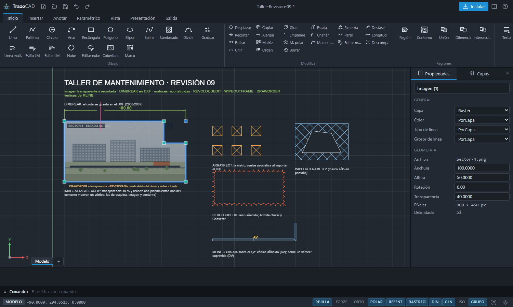
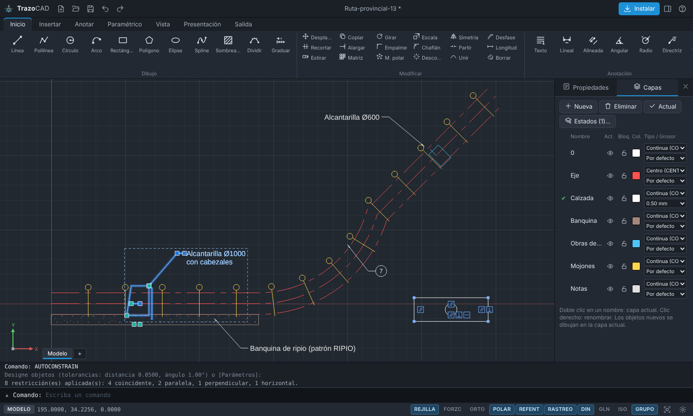
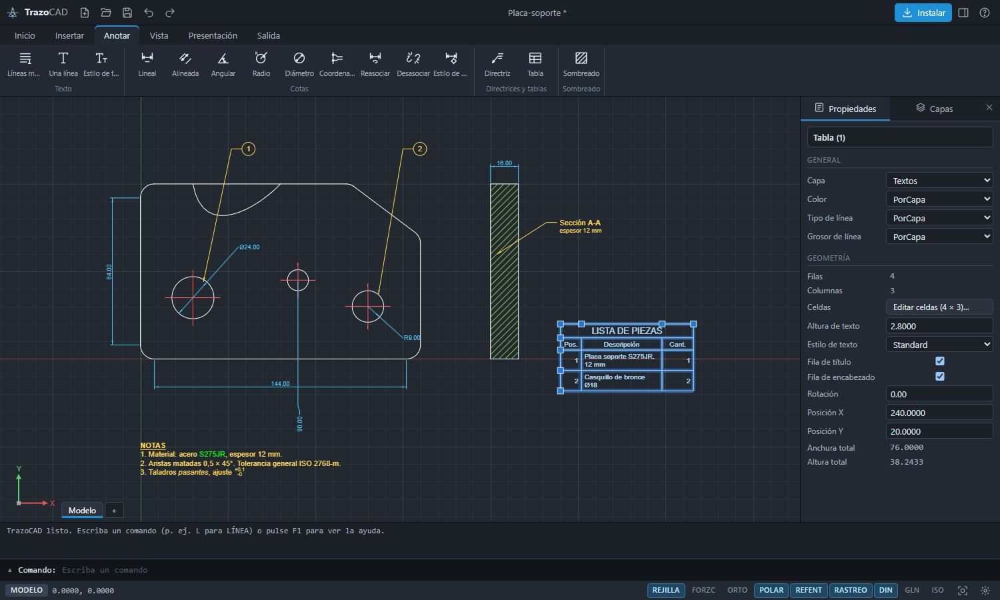

# TrazoCAD — v0.9

Software de dibujo técnico 2D inspirado en AutoCAD, hecho desde cero como **PWA** (aplicación web instalable y sin conexión). JavaScript puro con módulos ES: sin dependencias ni compilación.


## Ejecutar

```bash
node serve.mjs          # http://localhost:8080
```

Una PWA necesita `http://localhost` o HTTPS. Para publicarla, sube la carpeta tal cual a cualquier hosting estático con HTTPS (GitHub Pages, Netlify, Hostinger…). En Chrome/Edge aparece el botón **Instalar**.

## Novedades de la v0.9



| Función | Detalle |
|---|---|
| **Imágenes raster completas** (`IMAGEATTACH`, `XCLIP`) | **Transparencia** (0–90, como IMAGEADJUST de AutoCAD) que se respeta en pantalla, SVG y PDF. El recorte es **editable con pinzamientos**: los del contorno mueven cada vértice por separado y los de esquina desplazan la imagen y su recorte juntos. En DXF 2007 y 2000 la imagen se escribe como **IMAGE** con su **IMAGEDEF** (fuente incrustada en datos extendidos troceados) y el recorte y la transparencia en XDATA; en PDF se incrusta el mapa de bits, con su transparencia, escalado a la página |
| **Cortes de cota en DXF** | DIMBREAK escribe sus cortes en la cota (XDATA de DIMENSION) en DXF 2000 y 2007, y al importar se recuperan en su posición y longitud |
| **Matrices reconstruidas** | Al importar un DXF creado con TrazoCAD, las matrices rectangulares, polares y de recorrido vuelven como matrices asociativas con sus parámetros (columnas, filas, separaciones, ángulo de filas, niveles, elementos de origen), no como bloques sueltos |
| **Nubes, coberturas y orden de dibujo** | `REVCLOUDEDIT` añade un arco en el tramo designado, quita el arco designado o convierte la nube en una polilínea normal (con al menos cuatro arcos). `WIPEOUTFRAME` elige el marco de las coberturas (0 oculto, 1 visible e impreso, 2 sólo en pantalla). `DRAWORDER` lleva los objetos designados al frente o detrás del resto. Nuevas herramientas en la cinta |
| **Vértices de líneas múltiples** | Con **Ctrl+clic** en un pinzamiento de vértice se suprime ese vértice; con Ctrl+clic sobre el eje de un tramo se añade uno nuevo, y los cortes de MLEDIT de los tramos afectados se conservan o se ajustan |
| **Otros** | Archivos `.tcad` versión 9 (los anteriores se siguen abriendo). Las nubes de revisión, las coberturas y las imágenes se dibujan también en SVG y PDF; la ayuda (F1) recoge las novedades |

## Novedades de la v0.8


| Función | Detalle |
|---|---|
| **Edición de líneas múltiples** (`MLEDIT`, `-MLEDIT`) | Cuadro de herramientas y opciones por línea de comandos: cruces cerrada, abierta y combinada (CC, OC, MC), uniones en T cerrada, abierta y combinada (CT, OT, MT), unión en esquina (CJ), añadir y suprimir vértices (AV, DV), cortar uno o todo (CS, CA) y soldar (WA). Los cortes se guardan en la línea múltiple, se conservan al mover, girar, copiar y deshacer y se exportan a DXF 2000 y 2007; en R12 la MLINE se descompone con los cortes ya aplicados |
| **Matrices editables** (`ARRAYEDIT`) | **Origen** sustituye los objetos que genera la matriz; **ReemplaZar** sustituye un elemento concreto por otros objetos conservando la asociatividad. La matriz rectangular añade **niveles** con su separación Z y **ángulo de filas** (+ = antihorario, 0 = filas perpendiculares a las columnas). Los pinzamientos y la paleta de Propiedades reflejan los nuevos parámetros |
| **Marcas y líneas de centro** (`CENTERMARK`, `CENTERLINE`) | Marcas de centro en círculos y arcos, y líneas de centro entre dos líneas o entre dos círculos/arcos. Son asociativas: siguen al objeto al mover, girar, escalar, estirar, copiar y deshacer; el tamaño se toma de la altura de texto del estilo de cota. En DXF se escriben como líneas y arcos |
| **Cortes y espaciado de cotas** (`DIMBREAK`, `DIMSPACE`) | DIMBREAK rompe la línea de cota y sus líneas de referencia donde las cruzan otros objetos, de forma automática o designando los objetos, y permite añadir o quitar cortes. DIMSPACE separa cotas lineales o alineadas paralelas a partir de una cota base; con espaciado 0 las alinea |
| **Estados de capa en DXF** | Se exportan e importan como objetos **LAYERSTATE** en DXF 2000 y 2007, con las mismas propiedades que los archivos `.las`: capa actual, descripción y, por capa, activada, bloqueada, color, tipo y grosor de línea |
| **Nubes y coberturas** (`REVCLOUD`, `WIPEOUT`) | Nubes de revisión rectangulares, poligonales o a partir de un contorno cerrado (polilínea, círculo, elipse o región), con longitud de arco y arcos hacia fuera; sustituyen el contorno. Las coberturas son polígonos con deshacer que ocultan lo dibujado debajo; se exportan a DXF como HATCH sólido |
| **Imágenes raster** (`IMAGEATTACH`) | Adjunta PNG, JPEG, GIF, WebP o BMP con punto de inserción y escala; la imagen se guarda incrustada en el `.tcad`, así que no depende del archivo original. Se puede mover, girar, escalar y recortar con **XCLIP**, normal o invertido, con el marco configurable. Se dibuja en pantalla, PNG y SVG; en PDF se muestra su marco |
| **Otros** | Archivos `.tcad` versión 8 (los anteriores se siguen abriendo). Nuevas herramientas en la cinta y diálogo de MLEDIT; los cortes de línea múltiple y los estados de capa se conservan al guardar y abrir DXF 2000/2007 |

## Novedades de la v0.7


| Función | Detalle |
|---|---|
| **Líneas múltiples** (`MLINE`, `MLSTYLE`) | Elementos paralelos (muros, calzadas, cañerías) dibujados como una polilínea, con justificación superior, cero o inferior, escala, cierre y deshacer. Los estilos (ESTILOLM) definen cada elemento con su desfase, color y tipo de línea, remates de línea, de arco exterior o de arcos interiores al inicio y al final, ingletes visibles y relleno, con vista previa. Pinzamientos en los vértices, simetría que conserva el lado de cada elemento, propiedades editables (estilo, justificación, escala) y descomposición en líneas y arcos. MLINE y MLINESTYLE en DXF 2000 y 2007, de ida y vuelta |
| **Matrices asociativas** (`ARRAYRECT`, `ARRAYPOLAR`, `ARRAYPATH`, `ARRAYEDIT`) | Las matrices son un único objeto que guarda sus objetos de origen y sus parámetros: recuento y separación de filas y columnas, número de elementos, ángulo a rellenar o entre elementos, girar los elementos. **ARRAYPATH** reparte los objetos a lo largo de una línea, arco, círculo, polilínea, spline o elipse, con separación fija (Medir) o en todo el recorrido (Dividir), alineados o no; si el recorrido cambia, la matriz lo sigue. Se editan con ARRAYEDIT, con pinzamientos cian (separaciones, recuento, ángulo) o en Propiedades; se desplazan, giran, escalan y copian enteras. Con ASOciativa = No se crean copias sueltas, como antes |
| **Regiones y contornos** (`REGION`, `UNION`, `SUBTRACT`, `INTERSECT`, `BOUNDARY`) | REGION convierte círculos, polilíneas, elipses y splines cerradas, o cadenas de líneas y arcos que se cierran, en regiones. Las operaciones booleanas trabajan sobre la geometría exacta: los arcos siguen siendo arcos, los huecos se conservan y la unión de regiones separadas da un solo objeto. CONTORNO (`BO`) crea una polilínea con arcos o una región con el contorno que rodea un punto, con sus islas. Área y perímetro en Propiedades, ÁREA y campos; sirven de contorno de sombreado |
| **Cotas de longitud de arco y de radio con recodo** (`DIMARC`, `DIMJOGGED`) | DIMARC acota la longitud de un arco o de un tramo de arco de polilínea, entera o parcial (dos puntos sobre el arco), con el símbolo de arco sobre el texto y líneas de referencia paralelas (menos de 90°) o radiales. DIMJOGGED acota el radio de arcos y círculos grandes con el centro desplazado y el recodo a 45°. Ambas son asociativas y se exportan en DXF 2007 como ARC_DIMENSION y LARGE_RADIAL_DIMENSION |
| **Delimitación de referencias** (`XCLIP`, `XCLIPFRAME`) | Recorta referencias a bloques y referencias externas con un contorno rectangular, poligonal o una polilínea cerrada, normal o **invertido** (oculta lo de dentro). Activar, desactivar, suprimir y generar la polilínea del contorno. El recorte afecta al dibujo, la designación, las referencias a objetos, SVG y PDF; XCLIPFRAME muestra el marco (oculto, impreso o sólo en pantalla). En DXF se escribe como SPATIAL_FILTER en el diccionario de extensión de la referencia |
| **Tablas en DXF** | En DXF 2007 las tablas se escriben como **ACAD_TABLE** (filas, columnas, alturas, anchuras, celdas con el título combinado) con su bloque `*T` y sus estilos como **TABLESTYLE**; al importar se recuperan como tablas editables con su estilo |
| **Estados de capa en archivos `.las`** | Botones «Importar .las…» y «Exportar .las…» en el administrador de estados de capa y opciones Importar y eXportar de -LAYERSTATE: el formato de AutoCAD con la capa actual, la descripción y, por capa, activada, bloqueada, color, tipo y grosor de línea |
| **Otros** | Archivos `.tcad` versión 7. Los diálogos abiertos desde otro (por ejemplo «Nuevo» en un administrador de estilos) vuelven al anterior al cerrarse. LIMPIA elimina los estilos de línea múltiple sin uso; IGUALARPROP copia el estilo, la escala y la justificación de las líneas múltiples |

## Novedades de la v0.6



| Función | Detalle |
|---|---|
| **Grupos** (`GROUP`, `UNGROUP`, `GROUPEDIT`, `CLASSICGROUP`) | Conjuntos de objetos con nombre y descripción, o sin nombre (`*A1`…). Designar un objeto designa el grupo entero, con un recuadro discontinuo; el botón **GRUPO** de la barra de estado (Ctrl+Mayús+A) activa o desactiva la selección de grupos. Añadir y quitar miembros, renombrar, hacerlos no seleccionables y desagrupar. Copiar, desplazar con copia, simetría y matrices crean grupos sin nombre con las copias; el portapapeles los conserva. Se exportan e importan en DXF 2000 y 2007 (objetos GROUP) |
| **Dividir y graduar** (`DIVIDE`, `MEASURE`) | Puntos o referencias a un bloque, alineadas con el objeto o no, en partes iguales o cada cierta longitud, sobre líneas, arcos, círculos, polilíneas con arcos, splines y elipses. GRADUA empieza en el extremo más próximo al punto con que se designó el objeto; los bloques reciben los valores por defecto de sus atributos |
| **Estados de capa** (`LAYERSTATE`, `-LAYERSTATE`) | Guardan con un nombre y una descripción la configuración de todas las capas (activada, bloqueada, color, tipo y grosor de línea) y la capa actual. Al restaurar se eligen las propiedades y si se desactivan las capas creadas después; se marca el estado que coincide con la configuración actual. Botón «Estados» en la cinta y en la paleta de capas; al renombrar una capa los estados se actualizan |
| **Patrones de sombreado personalizados** (`PATTERNS`, `PATRONES`) | Carga archivos `.pat` de AutoCAD (acadiso.pat, acad.pat en pulgadas o propios) o definiciones pegadas; los patrones se guardan en el dibujo, aparecen en el selector de SOMBREADO y en Propiedades, y se exportan a `.pat`. Patrón **definido por el usuario** (opción Usuario de SOMBREADO): líneas paralelas o cruzadas con su separación. En DXF se escriben con sus líneas (tipos predefinido, de usuario y personalizado) y al importar se recuperan los patrones desconocidos |
| **Restricciones automáticas** (`AUTOCONSTRAIN`) | Aplica de una vez las restricciones que la geometría designada ya cumple dentro de una tolerancia de distancia y de ángulo: coincidente (también punto sobre objeto), colineal, paralela, perpendicular, tangente, concéntrica, horizontal, vertical e igual, en el orden de prioridad de AutoCAD. Sólo se añaden las independientes (rango del jacobiano), así que no quedan restricciones redundantes; la opción Parámetros cambia tolerancias y tipos |
| **Bloques dinámicos** (`BPARAMETER`, `BLOOKUPTABLE`) | Varios parámetros lineales por bloque, **parámetro de rotación** con pinzamiento y **tabla de consulta**: filas con nombre que fijan a la vez distancias, ángulos, visibilidad y simetría (celda vacía = sin cambio). La fila se elige con el pinzamiento triangular o en la paleta de Propiedades, que muestra «Personalizado» si los valores no coinciden con ninguna. Los bloques de la v0.5 se siguen leyendo |
| **DXF 2007** | Nueva versión por defecto de DXFOUT (AC1021, UTF-8). Las directrices múltiples se escriben como **MULTILEADER** con sus estilos (MLEADERSTYLE), texto con formato, rellano y flecha, y los globos como directrices con un bloque con atributo; los **degradados** como degradados. En DXF 2000 y R12 los caracteres no ASCII se escriben como `\U+XXXX`; al importar se detecta la codificación (UTF-8 o Windows-1252) y se leen los estilos de directriz y los globos de MULTILEADER |
| **Otros** | Archivos `.tcad` versión 6 (los anteriores se siguen abriendo). LIMPIA elimina los patrones personalizados sin uso; IGUALARPROP copia también los patrones de usuario. Los patrones personalizados de un dibujo enlazado como referencia externa pasan al dibujo |

## Novedades de la v0.5


| Función | Detalle |
|---|---|
| **Cotas en serie** (`DIMCONTINUE`, `DIMBASELINE`, `QDIM`) | Encadenadas o desde una línea base (separación DIMDLI del estilo), lineales, angulares y de coordenadas; QDIM acota de una vez los extremos y centros de una selección. Todas asociativas |
| **Restricciones paramétricas** (pestaña Paramétrico) | Geométricas: horizontal, vertical, paralela, perpendicular, coincidente, concéntrica, igual, fija, tangente, colineal. De cota: lineal, horizontal, vertical, alineada, radio, diámetro, angular, con nombre y expresión (`d2 = d1/2`). Solucionador de cambio mínimo; doble clic en una cota de restricción para cambiarla; `PARAMETERS`, `DELCONSTRAINT`, `CONSTRAINTBAR` |
| **Bloques dinámicos** (`BPARAMETER`, `BVSTATE`, `BVHIDE`, `BVSHOW`) | Estiramiento lineal, simetría y estados de visibilidad; pinzamientos cian y propiedades «Personalizado» en las referencias; en DXF se escriben como bloques anónimos |
| **Campos** (`FIELD`) | Fecha, archivo, presentación, escala, autor o propiedad de un objeto (área, longitud, radio…), que se actualizan solos; el cajetín los usa |
| **Estilos de directriz y de tabla** (`MLEADERSTYLE`, `TABLESTYLE`) | Las directrices y tablas toman los valores de su estilo salvo los que se modifiquen en cada objeto |
| **Degradados** (`GRADIENT`) | Lineal, cilíndrico, esférico y semiesférico, con dos colores; asociativos; SVG y PDF los conservan |
| **PDF vectorial** (`PDFOUT`) | Presentaciones a escala real (todas en un archivo) o el modelo ajustado a A3, con texto seleccionable |

## Novedades de la v0.4



| Función | Detalle |
|---|---|
| **Cotas asociativas** | Los puntos de una cota designados con referencia a objetos (punto final, medio, centro, cuadrante, intersección…) quedan unidos a la geometría. Al modificarla con pinzamientos, desplazar, girar o estirar, la cota se recalcula; la vista previa de los pinzamientos ya muestra la cota (y los sombreados asociativos) actualizados. Las cotas de radio, diámetro y angulares se asocian al círculo, arco o par de líneas. Copiar geometría y cota juntas mantiene la asociación; mover la cota sola o borrar la geometría la quita, como en AutoCAD. INTRO en la primera solicitud de `DIMLINEAR`/`DIMALIGNED` acota directamente una línea, un arco o un tramo de polilínea. `DIMDISASSOCIATE` y `DIMREASSOCIATE`; casilla «Cotas asociativas» en Parámetros de dibujo |
| **Directrices múltiples** (`MLEADER`, `LE`) | Punta de flecha, vértices y rellano horizontal; contenido de texto con formato, globo numerado (se autoincrementa) o ninguno. Flecha y altura tomadas del estilo de cota actual. Pinzamientos en los vértices y en el rellano, simetría con el texto legible, propiedades editables |
| **Tablas** (`TABLE`, `TB`) | Fila de título, fila de encabezados y celdas cuyo texto se ajusta a la anchura de la columna (la fila crece). Editor de celdas con filas y columnas añadibles; admite pegar un rango copiado de una hoja de cálculo. Números alineados a la derecha. Pinzamientos para el ancho de columnas y el alto de filas; doble clic sobre una celda para editarla |
| **Formato dentro de MTEXT** | Editor visual con barra: fuente, altura, negrita, cursiva, subrayado, sobrerrayado, tachado, color, fracciones apiladas (`1/2`, `1#2`, tolerancias `^`) y símbolos ° ± Ø. Se guarda con los códigos de AutoCAD (`\f`, `\H`, `\C`, `\L`, `\S`…), así que el formato pasa intacto por DXF |
| **Recortar, alargar, desfasar y partir splines** | Las splines se recortan y parten con su geometría exacta (inserción de nudos); se alargan en la dirección de su tangente (las de ajuste añaden un punto); se desfasan; y las intersecciones con líneas, arcos y círculos se refinan sobre la curva exacta, no sobre su teselado. También sirven de contorno para recortar y alargar otros objetos |
| **Editor de bloques** (`BEDIT`, `BSAVE`, `BCLOSE`, `BASE`) | Edita la definición de un bloque con todos los comandos, en un espacio propio con el punto base marcado y una barra Guardar/Cerrar. Al guardar se actualizan todas las referencias. Deshacer funciona dentro del editor y puede volver a abrirlo |
| **Referencias externas** (`XATTACH`, `XREF`) | Enlaza otro dibujo `.tcad` o `.dxf` como referencia: capas, bloques y estilos con el prefijo `NOMBRE\|`, contenido en caché dentro del dibujo, no descomponible ni editable como bloque. El administrador permite recargar (conserva el estado de las capas), desenlazar o unir (pasa a bloque normal con capas `NOMBRE$0$…`). `BASE` fija el punto de inserción del dibujo |
| **DXF** | Las cotas se exportan como entidades `DIMENSION` con su bloque anónimo (`*D1`…) y la tabla `DIMSTYLE` completa; las directrices como `LEADER` con su MTEXT enlazado; MTEXT conserva el formato; nombres con `\|` se escriben como `$0$`. Al importar se leen `DIMENSION` (todas las clases), `DIMSTYLE`, `LEADER`, `MULTILEADER`, `ACAD_TABLE`, `$INSBASE` y los códigos `%%d`, `%%p`, `%%c` |
| **Otros** | Archivos `.tcad` versión 4 (los anteriores se siguen abriendo) |

## Novedades de la v0.3


| Función | Detalle |
|---|---|
| **Sombreado asociativo** | El sombreado recuerda su contorno (punto interior o objetos designados) y se recalcula al modificarlo: pinzamientos, desplazar, estirar, girar… Copiar contorno y sombreado juntos mantiene la asociación con las copias. Mover el sombreado solo o borrar el contorno lo vuelve no asociativo, como en AutoCAD. Opción `asOciativo` en SOMBREADO y casilla en Propiedades |
| **Atributos de bloque** (`ATTDEF`, `ATTEDIT`) | Textos variables dentro de los bloques: etiqueta, solicitud, valor por defecto, invisible. INSERT pide los valores; doble clic en la referencia, ATTEDIT o la paleta de Propiedades los cambian. Al redefinir un bloque, las referencias muestran los atributos nuevos con su valor por defecto. El cajetín de las presentaciones es ahora un bloque con atributos (título, presentación, escala, fecha) |
| **Texto de líneas múltiples** (`MTEXT`, `T`) | Párrafos con ajuste de palabras a una anchura, nueve justificaciones, interlineado, rotación y simetría legible. Editor con varias líneas; doble clic para editar. `T` abre ahora MTEXT, como en AutoCAD (TEXT sigue en `DT`) |
| **Splines** (`SPLINE`, `SPL`) | Por puntos de ajuste (cúbica con parametrización por cuerda) o por vértices de control, abiertas o cerradas (periódicas). Pinzamientos en los puntos de ajuste o de control, contornos de sombreado, área, estirar y descomponer a polilínea |
| **Cotas angulares y de coordenadas** (`DIMANGULAR`, `DIMORDINATE`) | Angular entre dos líneas (elige el cuadrante según la posición del arco), de un arco, de un círculo o por tres puntos, con líneas de referencia automáticas. De coordenadas X/Y con directriz quebrada. Nuevo campo «Decimales angulares» en el estilo de cota |
| **Capas por ventana gráfica** (`VPLAYER`) | Con una ventana activa (doble clic dentro), la columna «Vent.» de la paleta de capas oculta una capa sólo en esa ventana. VPLAYER admite listas con comodines y las opciones Todas/Designar/Actual. Se respeta al dibujar, designar, imprimir y exportar |
| **DXF de presentaciones** | DXF 2000 escribe cada presentación como espacio papel (`*Paper_Space`, `*Paper_Space0`…) con objetos LAYOUT, tamaño de papel y entidades VIEWPORT con su escala, centro y capas inutilizadas. También MTEXT, SPLINE, ATTDEF y ATTRIB. La importación lee todo ello de vuelta, además de aristas spline en contornos de sombreado y los códigos de formato de MTEXT |
| **Otros** | Las entidades de un bloque situadas en una capa desactivada ya no se dibujan. Archivos `.tcad` versión 3 (los de la v0.1 y v0.2 se siguen abriendo) |

## Novedades de la v0.2

| Función | Detalle |
|---|---|
| **Sombreado** (`HATCH`, `H`, `SOMBREADO`) | Punto interior con detección automática del contorno e islas, o selección de objetos cerrados. Patrones SOLID, ANSI31, ANSI32, ANSI37, NET, LINE, DASH, BRICK, CROSS, DOTS y EARTH (formato acad.pat), con escala y ángulo, y un selector visual de patrones |
| **Bloques** (`BLOCK`/`B`, `INSERT`/`I`) | Definición con punto base, referencias con escala, rotación y simetría, bloques anidados, capa 0 y PorBloque heredados, referencias a objetos dentro de bloques, redefinición, selector con vista previa, `PURGE` |
| **Polilíneas con arcos** | `PLINE` con modo Arco (tangente) / Línea. Recortar, alargar, desfase, partir, unir, descomponer, pinzamientos de arco, área y longitud exactas |
| **Presentaciones** (espacio papel) | Pestañas Modelo / Presentación, marco y cajetín automáticos, ventanas gráficas (`MVIEW`) a escala estándar, `MSPACE`/`PSPACE` y doble clic para trabajar a través de una ventana, `PAGESETUP` (A4…A0, Carta, Oficio), impresión/SVG/PNG a escala real |
| **Estilos** | `STYLE` (fuente, anchura, oblicuidad) y `DIMSTYLE` (alturas, flechas cerrada/abierta/oblicua/punto, decimales, sufijo, escala global) con vista previa |
| **Edición** | `CHAMFER` (líneas y polilíneas), `FILLET` en polilíneas, `BREAK`, `BREAKATPOINT`, `LENGTHEN` (incremento, porcentaje, total, dinámica) |
| **Isométrico** | Rejilla, forzado y orto isométricos; `F5`/`Ctrl+E` cambia de plano; isocírculos en `ELLIPSE` |
| **Rendimiento** | Índice espacial (árbol R empaquetado con STR) para designación, referencias a objetos y dibujado |
| **DXF 2000** | Exporta AC1015 con identificadores, tablas (capas, tipos de línea, estilos, registros de bloque), LWPOLYLINE con curvatura, HATCH con datos de patrón, ELLIPSE, INSERT, color verdadero y grosor de línea. R12 sigue disponible. Al importar se conservan los bloques, las polilíneas con arcos y los sombreados |

## Base de la v0.1

Línea de comandos con alias y opciones, entrada de coordenadas (`x,y`, `@dx,dy`, `@d<a`, distancia directa), referencias a objetos (punto final, medio, centro, cuadrante, intersección, perpendicular, cercano), ORTO, POLAR, RASTREO, FORZC, entrada dinámica, selección por ventana o captura, pinzamientos, capas, paleta de propiedades, cotas, deshacer ilimitado y autoguardado. Pulsa **F1** en la app para ver los más de 120 comandos.

## Estructura

```
index.html, manifest.webmanifest, sw.js   PWA
css/app.css                               Interfaz
js/geom.js       Vectores, matrices, intersecciones, curvaturas
js/colors.js     Colores ACI ↔ RGB
js/spline.js     B-splines: De Boor, interpolación, teselado, inserción de nudos, tramos y uniones
js/richtext.js   Códigos de formato de MTEXT: análisis y escritura
js/entities.js   Tipos de entidad (línea … spline, texto con formato, directriz, tabla, atributo, sombreado, bloque, línea múltiple, región, matriz, ventana, cobertura, imagen)
js/mline.js      Líneas múltiples: estilos, ingletes, remates, relleno y edición MLEDIT
js/region.js     Regiones: contornos con arcos, operaciones booleanas, cadenas de líneas y arcos, contornos exactos de CONTORNO
js/arrays.js     Matrices asociativas: rectangular (con niveles y ángulo de filas), polar y a lo largo de un recorrido; origen, reemplazo, elementos, pinzamientos y propiedades
js/xclip.js      Delimitación de referencias (XCLIP): recorte de primitivas con el contorno
js/assoc.js      Cotas asociativas y marcas/líneas de centro: referencias a la geometría y recálculo
js/document.js   Capas, modelo, presentaciones, bloques, editor de bloques, estilos, grupos, estados de capa, patrones, deshacer, asociatividad (también matriz–recorrido)
js/xref.js       Referencias externas: lectura, prefijos, recarga, desenlace y unión
js/constraints.js Restricciones paramétricas, expresiones, solucionador y restricciones automáticas
js/dynblock.js   Bloques dinámicos: parámetros lineales, de rotación, simetría, visibilidad y tabla de consulta
js/groups.js     Grupos: creación, selección conjunta, copias y limpieza
js/layerstates.js Estados de capa: guardar, restaurar, comparar, renombrar y archivos .las
js/pdf.js        Exportación a PDF vectorial
js/patterns.js   Patrones de sombreado (predefinidos, personalizados .pat y de usuario), degradados y recorte de líneas de patrón
js/hatch.js      Detección de contornos (grafo plano, caras e islas, con las primitivas de origen) y recálculo asociativo
js/spatial.js    Índice espacial
js/view.js       Vista del modelo/papel y vista a través de ventana gráfica
js/render.js     Dibujado en canvas
js/snap.js       Referencias, rastreo, polar, orto, isométrico
js/ops.js        Recortar, alargar, partir, longitud, desfase, empalme, chaflán, unir, recorrido por longitud (GRADUA, DIVIDE)…
js/commands.js   Comandos y alias
js/dxf.js        DXF 2007 (MULTILEADER, ACAD_TABLE, ARC_DIMENSION, imágenes, DIMBREAK, matrices y degradados) / 2000 (ambos con presentaciones, grupos, MLINE con cortes, IMAGE, XCLIP y estados de capa) / R12
js/io.js         Abrir, guardar, exportar SVG/PNG (con imágenes), imprimir
js/ui.js         Cinta, paletas, barra de estado, diálogos (incluido el de MLEDIT)
js/app.js        Núcleo: entrada, motor de comandos, presentaciones
tools/           Pruebas en Chrome sin interfaz (run.mjs, tests/); sólo para desarrollo
```

## Limitaciones conocidas

- La asociatividad de cotas y sombreados no se exporta a DXF: AutoCAD los abre como cotas y sombreados normales (las cotas sí como entidades DIMENSION editables). Una cota asociada a un punto de una polilínea sigue al vértice por su número; si se recorta o parte el objeto, la cota pierde la asociación.
- En DXF 2000 las directrices se exportan como LEADER + MTEXT (ese formato no tiene MULTILEADER) y los globos como círculo y texto; en DXF 2007, como MULTILEADER. Las flechas abiertas, de trazo oblicuo y de punto se exportan como cerradas en los MULTILEADER. En DXF 2007 las tablas se exportan como ACAD_TABLE con sus estilos (sólo celdas de texto, sin formato por celda); en DXF 2000 y R12, descompuestas en líneas y MTEXT.
- En las fracciones apiladas y los colores de MTEXT se admite el subconjunto de códigos indicado; los códigos de párrafo (tabulaciones, sangrías, columnas) se descartan al importar.
- Las referencias externas se leen con el selector de archivos del navegador (una web no puede abrir rutas por sí sola): «Recargar» pide de nuevo el archivo salvo en la misma sesión. En DXF se exportan unidas (como bloques normales).
- Las splines cerradas se escriben en DXF como splines abiertas con los vértices repetidos (geometría idéntica). Al recortar o alargar una spline por vértices de control se convierte en una spline sin puntos de ajuste.
- Los atributos de una referencia no se pueden desplazar por separado: siguen la posición definida en el bloque. Al descomponer la referencia se convierten en textos con su valor.
- La exportación R12 sigue siendo sólo del espacio modelo y escribe las cotas, directrices y tablas descompuestas. En la importación, las referencias con escala no uniforme se descomponen.

- Las restricciones paramétricas y los parámetros dinámicos no se exportan a DXF: las referencias a bloques dinámicos se escriben como bloques anónimos con su geometría. En DXF 2000 los degradados se escriben como relleno sólido del color medio (en DXF 2007, como degradados).
- Los parámetros de un bloque dinámico actúan cada uno sobre la geometría original del bloque, en el orden lineales, rotaciones y simetría: no se encadenan (el centro de una rotación no se desplaza con un estiramiento).
- Los estados de capa se guardan en archivos `.las` y en DXF 2000/2007; al importar un `.las`, una capa inutilizada queda desactivada (TrazoCAD sólo inutiliza capas por ventana gráfica).
- AUTOCONSTRAIN trabaja con líneas, tramos rectos de polilíneas, arcos, círculos y puntos (no con elipses ni splines) y con unas 300 líneas por designación como máximo.
- Los patrones `.pat` se interpretan en las unidades del dibujo (milímetros, como acadiso.pat): los archivos en pulgadas, como acad.pat, se cargan marcando «En pulgadas». Un patrón en uso no se puede eliminar.
- GRADUA y DIVIDE recorren las elipses y las splines sobre su teselado (error inferior a una milésima de su tamaño).

- MLEDIT escribe los cortes en DXF 2000 y 2007 y los recupera al importar; en R12 las líneas múltiples se exportan descompuestas con los cortes aplicados, no como objetos MLINE.
- Las regiones se exportan a DXF como polilíneas cerradas (sin datos ACIS) y las entidades REGION de un DXF no se importan. Las elipses y las splines de una región se convierten en polígonos.
- Las matrices asociativas se exportan a DXF como un bloque anónimo con sus elementos y sus datos extendidos: TrazoCAD las reconstruye al importar, pero AutoCAD las abre como bloques, sin asociatividad. Una ARRAYPATH pierde la asociación con su recorrido al guardar (el identificador del recorrido no se escribe).
- DIMARC y DIMJOGGED se exportan descompuestas en DXF 2000 y R12; DIMARC no tiene directriz y el símbolo de arco va siempre encima del texto.
- Las marcas y líneas de centro se exportan a DXF como líneas y arcos sueltos, sin asociatividad; los cortes de DIMBREAK se escriben en DXF 2000 y 2007 como datos extendidos propios, que AutoCAD ignora.
- XCLIP no tiene planos de recorte delantero y trasero. La delimitación invertida o desactivada se guarda en el DXF como datos extendidos propios; R12 no conserva la delimitación, ni tampoco las referencias a bloques dinámicos en DXF. CONTORNO, como SOMBREADO, busca el contorno entre los objetos visibles en pantalla.
- Las imágenes raster se incrustan en el `.tcad` y se escriben en DXF 2007 y 2000 como IMAGE + IMAGEDEF, con la fuente y el recorte en datos extendidos propios: TrazoCAD las recupera completas al importar, pero AutoCAD necesita el archivo original en la ruta indicada y las abre sin recorte ni transparencia. R12 no admite imágenes. WIPEOUT se exporta como HATCH sólido y al importar vuelve como sombreado, así que el marco de las coberturas (WIPEOUTFRAME) no viaja en el DXF.
- Una nube de revisión convertida en polilínea con `REVCLOUDEDIT` vuelve a reconocerse como nube al exportar e importar DXF, porque el formato sólo guarda sus arcos (curvaturas).

## Hoja de ruta (v0.10+)

Escala real de las imágenes (píxeles por unidad y DPI al adjuntar) y recorte poligonal con varios contornos; cotas con tolerancias y estilos aplicados por objeto; sombreados con islas designadas y degradados de varias paradas; referencias externas recordadas entre sesiones y escritas como XREF; impresión con tablas de estilos de trazado (CTB/STB) y escala de tipo de línea por ventana gráfica; y una paleta de Propiedades múltiple para editar varios objetos a la vez.

