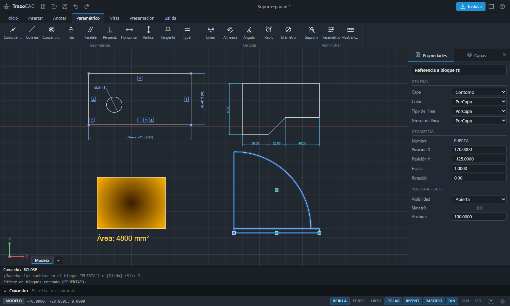
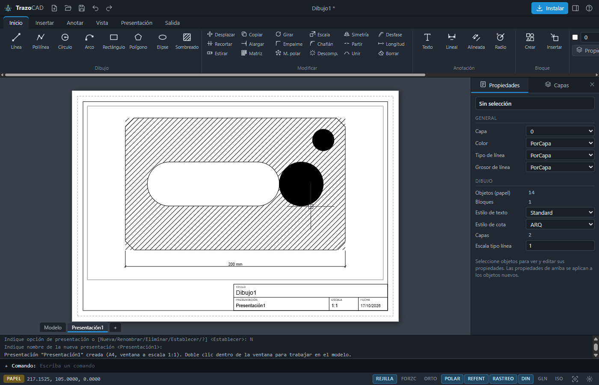

# TrazoCAD — v0.5

Software de dibujo técnico 2D inspirado en AutoCAD, hecho desde cero como **PWA** (aplicación web instalable y sin conexión). JavaScript puro con módulos ES: sin dependencias ni compilación.


## Ejecutar

```bash
node serve.mjs          # http://localhost:8080
```

Una PWA necesita `http://localhost` o HTTPS. Para publicarla, sube la carpeta tal cual a cualquier hosting estático con HTTPS (GitHub Pages, Netlify, Hostinger…). En Chrome/Edge aparece el botón **Instalar**.

## Novedades de la v0.5



| Función | Detalle |
|---|---|
| **Cotas en serie** (`DIMCONTINUE`, `DIMBASELINE`, `QDIM`) | Encadenadas o desde una línea base (separación DIMDLI del estilo), lineales, angulares y de coordenadas; QDIM acota de una vez los extremos y centros de una selección. Todas asociativas |
| **Restricciones paramétricas** (pestaña Paramétrico) | Geométricas: horizontal, vertical, paralela, perpendicular, coincidente, concéntrica, igual, fija, tangente, colineal. De cota: lineal, horizontal, vertical, alineada, radio, diámetro, angular, con nombre y expresión (`d2 = d1/2`). Solucionador de cambio mínimo; doble clic en una cota de restricción para cambiarla; `PARAMETERS`, `DELCONSTRAINT`, `CONSTRAINTBAR` |
| **Bloques dinámicos** (`BPARAMETER`, `BVSTATE`, `BVHIDE`, `BVSHOW`) | Estiramiento lineal, simetría y estados de visibilidad; pinzamientos cian y propiedades «Personalizado» en las referencias; en DXF se escriben como bloques anónimos |
| **Campos** (`FIELD`) | Fecha, archivo, presentación, escala, autor o propiedad de un objeto (área, longitud, radio…), que se actualizan solos; el cajetín los usa |
| **Estilos de directriz y de tabla** (`MLEADERSTYLE`, `TABLESTYLE`) | Las directrices y tablas toman los valores de su estilo salvo los que se modifiquen en cada objeto |
| **Degradados** (`GRADIENT`) | Lineal, cilíndrico, esférico y semiesférico, con dos colores; asociativos; SVG y PDF los conservan |
| **PDF vectorial** (`PDFOUT`) | Presentaciones a escala real (todas en un archivo) o el modelo ajustado a A3, con texto seleccionable |

## Novedades de la v0.4


| Función | Detalle |
|---|---|
| **Cotas asociativas** | Los puntos de una cota designados con referencia a objetos (punto final, medio, centro, cuadrante, intersección…) quedan unidos a la geometría. Al modificarla con pinzamientos, desplazar, girar o estirar, la cota se recalcula; la vista previa de los pinzamientos ya muestra la cota (y los sombreados asociativos) actualizados. Las cotas de radio, diámetro y angulares se asocian al círculo, arco o par de líneas. Copiar geometría y cota juntas mantiene la asociación; mover la cota sola o borrar la geometría la quita, como en AutoCAD. INTRO en la primera solicitud de `DIMLINEAR`/`DIMALIGNED` acota directamente una línea, un arco o un tramo de polilínea. `DIMDISASSOCIATE` y `DIMREASSOCIATE`; casilla «Cotas asociativas» en Parámetros de dibujo |
| **Directrices múltiples** (`MLEADER`, `LE`) | Punta de flecha, vértices y rellano horizontal; contenido de texto con formato, globo numerado (se autoincrementa) o ninguno. Flecha y altura tomadas del estilo de cota actual. Pinzamientos en los vértices y en el rellano, simetría con el texto legible, propiedades editables |
| **Tablas** (`TABLE`, `TB`) | Fila de título, fila de encabezados y celdas cuyo texto se ajusta a la anchura de la columna (la fila crece). Editor de celdas con filas y columnas añadibles; admite pegar un rango copiado de una hoja de cálculo. Números alineados a la derecha. Pinzamientos para el ancho de columnas y el alto de filas; doble clic sobre una celda para editarla |
| **Formato dentro de MTEXT** | Editor visual con barra: fuente, altura, negrita, cursiva, subrayado, sobrerrayado, tachado, color, fracciones apiladas (`1/2`, `1#2`, tolerancias `^`) y símbolos ° ± Ø. Se guarda con los códigos de AutoCAD (`\f`, `\H`, `\C`, `\L`, `\S`…), así que el formato pasa intacto por DXF |
| **Recortar, alargar, desfasar y partir splines** | Las splines se recortan y parten con su geometría exacta (inserción de nudos); se alargan en la dirección de su tangente (las de ajuste añaden un punto); se desfasan; y las intersecciones con líneas, arcos y círculos se refinan sobre la curva exacta, no sobre su teselado. También sirven de contorno para recortar y alargar otros objetos |
| **Editor de bloques** (`BEDIT`, `BSAVE`, `BCLOSE`, `BASE`) | Edita la definición de un bloque con todos los comandos, en un espacio propio con el punto base marcado y una barra Guardar/Cerrar. Al guardar se actualizan todas las referencias. Deshacer funciona dentro del editor y puede volver a abrirlo |
| **Referencias externas** (`XATTACH`, `XREF`) | Enlaza otro dibujo `.tcad` o `.dxf` como referencia: capas, bloques y estilos con el prefijo `NOMBRE\|`, contenido en caché dentro del dibujo, no descomponible ni editable como bloque. El administrador permite recargar (conserva el estado de las capas), desenlazar o unir (pasa a bloque normal con capas `NOMBRE$0$…`). `BASE` fija el punto de inserción del dibujo |
| **DXF** | Las cotas se exportan como entidades `DIMENSION` con su bloque anónimo (`*D1`…) y la tabla `DIMSTYLE` completa; las directrices como `LEADER` con su MTEXT enlazado; MTEXT conserva el formato; nombres con `\|` se escriben como `$0$`. Al importar se leen `DIMENSION` (todas las clases), `DIMSTYLE`, `LEADER`, `MULTILEADER`, `ACAD_TABLE`, `$INSBASE` y los códigos `%%d`, `%%p`, `%%c` |
| **Otros** | Archivos `.tcad` versión 4 (los anteriores se siguen abriendo) |

## Novedades de la v0.3



| Función | Detalle |
|---|---|
| **Sombreado asociativo** | El sombreado recuerda su contorno (punto interior o objetos designados) y se recalcula al modificarlo: pinzamientos, desplazar, estirar, girar… Copiar contorno y sombreado juntos mantiene la asociación con las copias. Mover el sombreado solo o borrar el contorno lo vuelve no asociativo, como en AutoCAD. Opción `asOciativo` en SOMBREADO y casilla en Propiedades |
| **Atributos de bloque** (`ATTDEF`, `ATTEDIT`) | Textos variables dentro de los bloques: etiqueta, solicitud, valor por defecto, invisible. INSERT pide los valores; doble clic en la referencia, ATTEDIT o la paleta de Propiedades los cambian. Al redefinir un bloque, las referencias muestran los atributos nuevos con su valor por defecto. El cajetín de las presentaciones es ahora un bloque con atributos (título, presentación, escala, fecha) |
| **Texto de líneas múltiples** (`MTEXT`, `T`) | Párrafos con ajuste de palabras a una anchura, nueve justificaciones, interlineado, rotación y simetría legible. Editor con varias líneas; doble clic para editar. `T` abre ahora MTEXT, como en AutoCAD (TEXT sigue en `DT`) |
| **Splines** (`SPLINE`, `SPL`) | Por puntos de ajuste (cúbica con parametrización por cuerda) o por vértices de control, abiertas o cerradas (periódicas). Pinzamientos en los puntos de ajuste o de control, contornos de sombreado, área, estirar y descomponer a polilínea |
| **Cotas angulares y de coordenadas** (`DIMANGULAR`, `DIMORDINATE`) | Angular entre dos líneas (elige el cuadrante según la posición del arco), de un arco, de un círculo o por tres puntos, con líneas de referencia automáticas. De coordenadas X/Y con directriz quebrada. Nuevo campo «Decimales angulares» en el estilo de cota |
| **Capas por ventana gráfica** (`VPLAYER`) | Con una ventana activa (doble clic dentro), la columna «Vent.» de la paleta de capas oculta una capa sólo en esa ventana. VPLAYER admite listas con comodines y las opciones Todas/Designar/Actual. Se respeta al dibujar, designar, imprimir y exportar |
| **DXF de presentaciones** | DXF 2000 escribe cada presentación como espacio papel (`*Paper_Space`, `*Paper_Space0`…) con objetos LAYOUT, tamaño de papel y entidades VIEWPORT con su escala, centro y capas inutilizadas. También MTEXT, SPLINE, ATTDEF y ATTRIB. La importación lee todo ello de vuelta, además de aristas spline en contornos de sombreado y los códigos de formato de MTEXT |
| **Otros** | Las entidades de un bloque situadas en una capa desactivada ya no se dibujan. Archivos `.tcad` versión 3 (los de la v0.1 y v0.2 se siguen abriendo) |

## Novedades de la v0.2

| Función | Detalle |
|---|---|
| **Sombreado** (`HATCH`, `H`, `SOMBREADO`) | Punto interior con detección automática del contorno e islas, o selección de objetos cerrados. Patrones SOLID, ANSI31, ANSI32, ANSI37, NET, LINE, DASH, BRICK, CROSS, DOTS y EARTH (formato acad.pat), con escala y ángulo, y un selector visual de patrones |
| **Bloques** (`BLOCK`/`B`, `INSERT`/`I`) | Definición con punto base, referencias con escala, rotación y simetría, bloques anidados, capa 0 y PorBloque heredados, referencias a objetos dentro de bloques, redefinición, selector con vista previa, `PURGE` |
| **Polilíneas con arcos** | `PLINE` con modo Arco (tangente) / Línea. Recortar, alargar, desfase, partir, unir, descomponer, pinzamientos de arco, área y longitud exactas |
| **Presentaciones** (espacio papel) | Pestañas Modelo / Presentación, marco y cajetín automáticos, ventanas gráficas (`MVIEW`) a escala estándar, `MSPACE`/`PSPACE` y doble clic para trabajar a través de una ventana, `PAGESETUP` (A4…A0, Carta, Oficio), impresión/SVG/PNG a escala real |
| **Estilos** | `STYLE` (fuente, anchura, oblicuidad) y `DIMSTYLE` (alturas, flechas cerrada/abierta/oblicua/punto, decimales, sufijo, escala global) con vista previa |
| **Edición** | `CHAMFER` (líneas y polilíneas), `FILLET` en polilíneas, `BREAK`, `BREAKATPOINT`, `LENGTHEN` (incremento, porcentaje, total, dinámica) |
| **Isométrico** | Rejilla, forzado y orto isométricos; `F5`/`Ctrl+E` cambia de plano; isocírculos en `ELLIPSE` |
| **Rendimiento** | Índice espacial (árbol R empaquetado con STR) para designación, referencias a objetos y dibujado |
| **DXF 2000** | Exporta AC1015 con identificadores, tablas (capas, tipos de línea, estilos, registros de bloque), LWPOLYLINE con curvatura, HATCH con datos de patrón, ELLIPSE, INSERT, color verdadero y grosor de línea. R12 sigue disponible. Al importar se conservan los bloques, las polilíneas con arcos y los sombreados |

## Base de la v0.1

Línea de comandos con alias y opciones, entrada de coordenadas (`x,y`, `@dx,dy`, `@d<a`, distancia directa), referencias a objetos (punto final, medio, centro, cuadrante, intersección, perpendicular, cercano), ORTO, POLAR, RASTREO, FORZC, entrada dinámica, selección por ventana o captura, pinzamientos, capas, paleta de propiedades, cotas, deshacer ilimitado y autoguardado. Pulsa **F1** en la app para ver los más de 120 comandos.

## Estructura

```
index.html, manifest.webmanifest, sw.js   PWA
css/app.css                               Interfaz
js/geom.js       Vectores, matrices, intersecciones, curvaturas
js/colors.js     Colores ACI ↔ RGB
js/spline.js     B-splines: De Boor, interpolación, teselado, inserción de nudos, tramos y uniones
js/richtext.js   Códigos de formato de MTEXT: análisis y escritura
js/entities.js   Tipos de entidad (línea … spline, texto con formato, directriz, tabla, atributo, sombreado, bloque, ventana)
js/assoc.js      Cotas asociativas: referencias a la geometría y recálculo
js/document.js   Capas, modelo, presentaciones, bloques, editor de bloques, estilos, deshacer, asociatividad
js/xref.js       Referencias externas: lectura, prefijos, recarga, desenlace y unión
js/constraints.js Restricciones paramétricas, expresiones y solucionador
js/dynblock.js   Bloques dinámicos
js/pdf.js        Exportación a PDF vectorial
js/patterns.js   Patrones de sombreado y recorte de líneas de patrón
js/hatch.js      Detección de contornos (grafo plano, caras e islas) y recálculo asociativo
js/spatial.js    Índice espacial
js/view.js       Vista del modelo/papel y vista a través de ventana gráfica
js/render.js     Dibujado en canvas
js/snap.js       Referencias, rastreo, polar, orto, isométrico
js/ops.js        Recortar, alargar, partir, longitud, desfase, empalme, chaflán, unir…
js/commands.js   Comandos y alias
js/dxf.js        DXF 2000 (con presentaciones) / R12
js/io.js         Abrir, guardar, exportar SVG/PNG, imprimir
js/ui.js         Cinta, paletas, barra de estado, diálogos
js/app.js        Núcleo: entrada, motor de comandos, presentaciones
```

## Limitaciones conocidas

- La asociatividad de cotas y sombreados no se exporta a DXF: AutoCAD los abre como cotas y sombreados normales (las cotas sí como entidades DIMENSION editables). Una cota asociada a un punto de una polilínea sigue al vértice por su número; si se recorta o parte el objeto, la cota pierde la asociación.
- Las directrices se exportan como LEADER + MTEXT (el formato DXF 2000 no tiene MULTILEADER) y los globos como círculo y texto; las tablas se exportan descompuestas en líneas y MTEXT. Los estilos de directriz y de tabla no se exportan a DXF.
- En las fracciones apiladas y los colores de MTEXT se admite el subconjunto de códigos indicado; los códigos de párrafo (tabulaciones, sangrías, columnas) se descartan al importar.
- Las referencias externas se leen con el selector de archivos del navegador (una web no puede abrir rutas por sí sola): «Recargar» pide de nuevo el archivo salvo en la misma sesión. En DXF se exportan unidas (como bloques normales).
- Las splines cerradas se escriben en DXF como splines abiertas con los vértices repetidos (geometría idéntica). Al recortar o alargar una spline por vértices de control se convierte en una spline sin puntos de ajuste.
- Los atributos de una referencia no se pueden desplazar por separado: siguen la posición definida en el bloque. Al descomponer la referencia se convierten en textos con su valor.
- La exportación R12 sigue siendo sólo del espacio modelo y escribe las cotas, directrices y tablas descompuestas. En la importación, las referencias con escala no uniforme se descomponen.

- Las restricciones paramétricas y los parámetros dinámicos no se exportan a DXF. En DXF 2000 los degradados se escriben como relleno sólido del color medio.

## Hoja de ruta (v0.6+)

Restricciones automáticas (AUTOCONSTRAIN), parámetros de rotación y tabla de consulta en bloques dinámicos, exportación DXF 2007+ con MULTILEADER y degradados, capas de estados (LAYERSTATE), grupos (GROUP), MEASURE/DIVIDE y sombreados con patrones personalizados.
